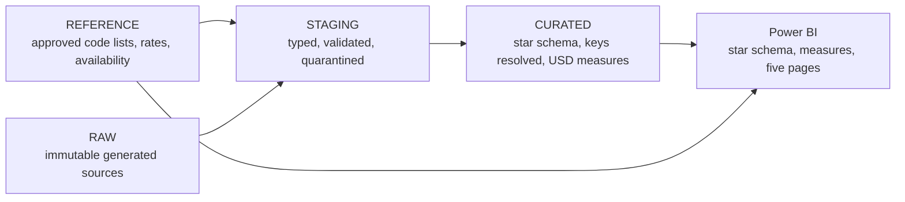

# AEROVISION 360 — Engineering Data Model Blueprint

**Status:** ENGINEERING PREPARATION — DESIGNED, NOT IMPLEMENTED; NOT A SCHEMA FREEZE
**Version:** 0.1
**Prepared:** 2026-11-02
**Governing contract:** `docs/03_DATA_CONTRACTS.md` version 1.5
**Business requirements:** `docs/02_BUSINESS_REQUIREMENTS.md` version 1.1
**Population and identity records:** `docs/OD01A_AIRLINE_POPULATION_DECISION.md`, `docs/OD01B_AIRLINE_IDENTITY_REFERENCE_DECISION.md`
**Project root:** `C:\Users\KHfar\OneDrive\Desktop\AEROVISION_360`

> **Status notice.** This is a design blueprint, not an implemented model or a schema freeze. OD-01A and OD-01B remain `OWNER-CONFIRMED DESIGN — FORMAL SIGNATURE AND APPROVAL PENDING`; G3 remains `NOT STARTED`; G4 remains `BLOCKED`; reference-data creation, synthetic-data generation, schema freeze, Power BI implementation, and Git operations remain unauthorized. No data, Python pipeline, Power Query query, semantic model, DAX measure, report, or dashboard exists because of this document.

## 1. Purpose and authority

This document turns the data contract into an implementation-level logical and physical model blueprint for the five core facts and their conformed dimensions. It is intended to be sufficient for a developer to create the CURATED layer and the Power BI star schema after the required approvals. It does not replace the contract.

**Precedence:** if this blueprint conflicts with `03_DATA_CONTRACTS.md` version 1.5, the contract controls and the conflict must be raised as `OWNER DECISION REQUIRED`. If a required design is not in the contract, it is not added silently.

**Canonical disclosure:** every report page, tooltip while a page is visible, and exported result must carry the exact string `Synthetic Simulation — Not Actual Airline Performance`.

## 2. Fixed boundaries

| Boundary | Design rule |
|---|---|
| Airline population | Exactly the ten real airline identities in contract Section 2.1 and OD-01A. No additions, removals, subsidiaries, franchises, or group consolidations. |
| Identity vs simulation | Airline identity attributes are real and require attribute-level source verification before reference approval. All flights, bookings, passengers, revenue, costs, disruptions, feedback, and financial results are synthetic simulations. |
| Reporting period | 2025-10-01 through 2026-09-30, inclusive. |
| Currency | USD is the only reporting currency. Original currencies are retained; conversion occurs once in STAGING/CURATED, never in DAX. |
| Date and time | UTC timestamps; local date keys derived through IANA time zones; DimDate covers 2024-10-01 through 2026-10-31. |
| History | `DimAirline` is Type 1 with immutable reference snapshots. Build reproducibility is preserved; as-was historical identity labels are not. Type 2 is deferred. |
| Reference version | One approved `ReferenceVersion` per generation and refresh. `DimAirline.ReferenceVersion` is hidden technical lineage; the reference manifest is the approval authority. |
| Authorization | No reference CSV, synthetic dataset, schema freeze, semantic model, DAX, report, or dashboard is authorized by this blueprint. |

## 3. Architecture

The model follows the contract's layered batch architecture: RAW → STAGING → CURATED, with REFERENCE available to STAGING and CURATED. Power BI consumes CURATED tables and approved reference tables only.

| Layer | Planned location | Model responsibility |
|---|---|---|
| RAW | `data/01_raw/<run_id>/` | Preserve generated source records and seeded defects exactly. |
| STAGING | `data/02_staging/<run_id>/` | Type, standardize, validate, quarantine, convert currency, assign dispositions. |
| CURATED | `data/03_curated/<run_id>/` | Publish dimensions and facts at the contract grain with resolved keys. |
| REFERENCE | `data/04_reference/` and `data/manifests/` | Approved reference versions, key map, manifest, and exchange rates. |

The model does not read RAW or STAGING in Power BI. It does not create a second revenue fact, a cost fact outside `FactOperatingCosts`, a fact-to-fact relationship, or a hidden aggregate row inside a detail fact.

## 4. Modeling conventions

### 4.1 Keys

- Every dimension and fact has a surrogate primary key.
- `AirlineKey` is the permanent positive `Int32` warehouse surrogate. It is assigned once from the controlled key map and never from row order, sort order, hash order, random choice, `IDENTITY`, or a rebuild-time sequence.
- `AirlineId` is the durable business identity. It is not a fact relationship key.
- `AirlineIATACode` and `AirlineICAOCode` are version-qualified attributes, never keys.
- General surrogate keys are deterministic integers from a documented sort order and are stable for the same seed, configuration, and code version.
- Key `-1` is reserved for an approved unknown member. The baseline does not use unknown members for required keys; invalid rows are quarantined instead.
- Fact logical references (`FlightOperationKey` in booking, cost, disruption, and feedback facts) support lineage and reconciliation only. They are not Power BI relationships.

### 4.2 Types, nullability, and units

| Concept | Contract rule |
|---|---|
| Surrogate key | `Int32` or `Int64`, positive; `-1` only for an approved unknown member |
| Business key | String, uppercase where applicable, trimmed |
| Date | ISO `YYYY-MM-DD`; `DateKey` is `YYYYMMDD` `Int32` |
| Timestamp | UTC ISO 8601 `YYYY-MM-DDThh:mm:ssZ` |
| Money | `Decimal(18,2)`; original currency or USD as named |
| Rate | `Decimal(18,6)`; USD per one unit of currency |
| Ratio | `Decimal(18,6)`; stored as a decimal fraction, not a formatted percentage |
| Distance | `Decimal(9,2)`; kilometres or miles |
| Boolean | `TRUE`/`FALSE` in CURATED, never `Y`/`N`/`1`/`0` |
| Text | UTF-8, trimmed, no control characters |
| Required value | Never null and never an empty string |
| Optional value | Null, not `N/A`, `Unknown`, `0`, or a placeholder |

### 4.3 Date semantics

| Fact | Active date role | Inactive date roles |
|---|---|---|
| FactFlightOperations | `ScheduledDepartureDateKey` (local origin) | `ScheduledArrivalDateKey` (local destination, overnight/cross-zone) |
| FactBookingTransactions | `TravelDateKey` (local coupon origin) | `BookingDateKey` (UTC booking cohort) |
| FactOperatingCosts | `CostDateKey` (accounting date) | None |
| FactDisruptions | `EventDateKey` (local event location) | None |
| FactCustomerFeedback | `FeedbackDateKey` (UTC submission) | `ResolutionDateKey` (UTC resolution) |

Delays are calculated from UTC timestamps in whole minutes, rounded half away from zero. Negative delay is valid and means early. Cancelled flights keep scheduled timestamps and date keys; actual timestamps and delays are null.

### 4.4 Currency

- Financial facts carry original-currency amount, `ExchangeRateToUSD`, and USD amount.
- Conversion is performed once using the exact-date synthetic rate. No period-average rate, no forward-fill, no DAX conversion.
- `TaxUSD` is a pass-through and is excluded from all revenue measures.
- `NetPassengerRevenueUSD`, `NetFeeRevenueUSD`, and `NetAncillaryRevenueUSD` are stored at coupon grain. Total operating revenue is their sum.
- Revenue exists only in `FactBookingTransactions`.

## 5. Dimensions

### 5.1 Dimension summary

| Dimension | Grain | Primary key | Business key | SCD | Unknown member | Planned rows |
|---|---|---|---|---|---:|---:|
| DimDate | One row per calendar date | DateKey | FullDate | Static | Not used | 761 |
| DimAirline | One row per airline (Type 1) | AirlineKey | AirlineId; version-qualified IATA/ICAO/name | Type 1 | Not used | 10 |
| DimAirport | One row per airport | AirportKey | AirportCode | Type 1 | Not used | 60–100 |
| DimRoute | One row per directional origin-destination pair | RouteKey | RouteCode; origin + destination | Type 1 | Not used | 300–500 |
| DimAircraft | One row per aircraft | AircraftKey | AircraftRegistration | Type 1 | Not used | 350–450 |
| DimAircraftType | One row per aircraft type | AircraftTypeKey | Manufacturer + AircraftModel | Type 1 | Not used | 12–18 |
| DimCustomer | One row per fictional customer | CustomerKey | CustomerID | Type 1 | Not used | 1.0–1.5 million |
| DimFareClass | One row per fare class | FareClassKey | FareClassCode | Static | Not used | 12 |
| DimBookingChannel | One row per channel | BookingChannelKey | ChannelCode; ChannelName | Static | Not used | 7 |
| DimDisruptionType | One row per disruption type | DisruptionTypeKey | DisruptionCode; DisruptionName | Static per version | Not used | 12–16 |
| DimCurrency | One row per ISO 4217 currency | CurrencyKey | CurrencyCode | Static | Not used | 5 |

Rows are planning targets, not generated data. `DimDate` must contain every date from 2024-10-01 through 2026-10-31 inclusive; verify the exact count (761) with T-02/T-50.

### 5.2 Dimension definitions

#### DimDate

**Purpose:** conformed calendar for flight, booking, cost, disruption, feedback, fiscal, and trend analysis.
**Columns:** `DateKey Int32` (PK, `YYYYMMDD`), `FullDate Date` (model date column), `Year Int16`, `Quarter Int8`, `MonthNumber Int8`, `MonthName String(20)`, `MonthShortName String(3)`, `YearMonth String(7)`, `YearMonthSort Int32`, `WeekNumber Int8` (ISO 8601), `WeekStartDate Date`, `DayOfMonth Int8`, `DayName String(10)`, `DayOfWeekNumber Int8` (ISO 1–7), `IsWeekend Boolean`, `IsReportingPeriod Boolean`, `FiscalYear Int16`, `FiscalQuarter Int8`, `FiscalMonthNumber Int8`.
**Rules:** no gaps or duplicates; `IsReportingPeriod = TRUE` only for 2025-10-01 through 2026-09-30; fiscal year starts 01 October; `MonthName` sorts by `MonthNumber`; `DayName` sorts by `DayOfWeekNumber`; `YearMonth` sorts by `YearMonthSort`.

#### DimAirline

**Purpose:** identify and compare the ten airline identities and their supported identity attributes.
**Columns:** `AirlineKey Int32` (PK, hidden), `AirlineId String(20)` (durable identity, `^AIR-[0-9]{4}$`, never reused), `AirlineIATACode String(2)`, `AirlineICAOCode String(3)`, `AirlineName String(100)`, `AirlineGroup String(100)` nullable, `HomeCountry String(100)`, `HomeCountryCode String(2)`, `BusinessModelClass String(50)` nullable analytical, `IsActive Boolean`, `StatusEffectiveDate Date` nullable, `ReferenceVersion String(30)` hidden lineage.
**Rules:** exactly 10 active rows in the baseline; `AirlineKey` permanent and unique; `AirlineId` unique and never reused; IATA/ICAO/name unique within `ReferenceVersion`; IATA/ICAO/name are mutable attributes, not keys; `LegalName` is not a column; `OperatingRegion` is not a column; `BusinessModelClass` is optional, nullable, labelled analytical, and excluded from identity provenance; `StatusEffectiveDate` is required only when `IsActive = FALSE`; `ReferenceVersion` is not approval. Source rows must reconcile exactly to `ref_airlines.csv` and attribute provenance in `ref_airline_sources.csv`. Type 1 only; no as-was identity labels.

**Proposed key map (OD-01B approval pending; not source-verified):**

| AirlineId | AirlineKey | Airline |
|---|---:|---|
| AIR-0001 | 1 | Emirates |
| AIR-0002 | 2 | Qatar Airways |
| AIR-0003 | 3 | Singapore Airlines |
| AIR-0004 | 4 | Air India |
| AIR-0005 | 5 | IndiGo |
| AIR-0006 | 6 | British Airways |
| AIR-0007 | 7 | Lufthansa |
| AIR-0008 | 8 | Delta Air Lines |
| AIR-0009 | 9 | Southwest Airlines |
| AIR-0010 | 10 | Qantas |

The key map is loaded from the approved manifest/key map, not derived during a rebuild.

#### DimAirport

**Purpose:** airport geography, codes, and IANA time zones for network and operations.
**Columns:** `AirportKey Int32` (PK), `AirportCode String(3)`, `AirportName String(100)`, `City String(100)`, `Country String(100)`, `CountryCode String(2)`, `Region String(50)`, `Latitude Decimal(9,6)`, `Longitude Decimal(9,6)`, `TimeZoneIANA String(64)`, `IsActive Boolean`.
**Rules:** unique three-letter uppercase code; airport codes/names are synthetic or explicitly fictional; coordinates in range; valid IANA zone, not an abbreviation; one airport may serve multiple airlines; `Region` is a controlled analytical grouping, not an airline identity attribute.

#### DimRoute

**Purpose:** directional route network, distance, region, and international status.
**Columns:** `RouteKey Int32` (PK), `RouteCode String(20)` (`ORIGIN-DEST`), `OriginAirportKey Int32`, `DestinationAirportKey Int32`, `DistanceKM Decimal(9,2)`, `DistanceMiles Decimal(9,2)`, `RouteRegion String(50)`, `IsInternational Boolean`, `IsActive Boolean`.
**Rules:** origin and destination differ; distance positive and within 2% of great-circle distance; miles = km × 0.621371 rounded to two decimals; route code unique; directional routes are separate; analytical region is derived from route/airport geography, not an airline attribute.

#### DimAircraft

**Purpose:** identify each aircraft, operator, type, capacity, and fleet status.
**Columns:** `AircraftKey Int32` (PK), `AircraftRegistration String(20)`, `AirlineKey Int32`, `AircraftTypeKey Int32`, `FleetEntryDate Date`, `FleetStatus String(30)`, `SeatCapacity Int16`, `PlannedDailyAvailableHours Decimal(4,2)`, `IsActive Boolean`.
**Rules:** unique fictional registration; exactly one operator in the baseline; `SeatCapacity` positive and not above type maximum; `FleetStatus` in Active/Maintenance/Stored/Retired; `PlannedDailyAvailableHours` baseline 14.00 is proposed under OD-10; `AirlineKey` is lineage only and has no active semantic relationship.

#### DimAircraftType

**Purpose:** generic aircraft type, category, capacity, and range reference.
**Columns:** `AircraftTypeKey Int32` (PK), `Manufacturer String(50)`, `AircraftModel String(50)`, `AircraftCategory String(30)`, `TypicalSeatCapacity Int16`, `MaximumSeatCapacity Int16`, `RangeKM Decimal(9,2)`, `BodyType String(30)`.
**Rules:** manufacturer + model unique; typical capacity positive and not above maximum; range positive; types are fictional/generic and must not support real fleet claims.

#### DimCustomer

**Purpose:** privacy-safe synthetic customer segmentation and behavior.
**Columns:** `CustomerKey Int32` (PK), `CustomerID String(20)`, `CustomerSegment String(30)`, `LoyaltyTier String(30)`, `HomeCountry String(100)`, `HomeCountryCode String(2)`, `RegistrationDate Date`, `IsActive Boolean`.
**Rules:** unique synthetic ID; no real names, email, phone, address, passport, or other personal identifiers; controlled segments and tiers; registration on or before first booking; Type 1 baseline.

#### DimFareClass

**Purpose:** fare/cabin taxonomy for fare mix and revenue analysis.
**Columns:** `FareClassKey Int32` (PK), `FareClassCode String(5)`, `FareClassName String(50)`, `CabinClass String(30)`, `RefundabilityCategory String(30)`, `IsAncillaryEligible Boolean`, `DisplayOrder Int16`.
**Rules:** unique code; cabin in Economy/Premium Economy/Business/First; refundability in Refundable/Partially Refundable/Non-Refundable; one cabin per fare class; display order unique within cabin.

#### DimBookingChannel

**Purpose:** distribution channel taxonomy.
**Columns:** `BookingChannelKey Int32` (PK), `ChannelCode String(10)`, `ChannelName String(50)`, `ChannelCategory String(30)`, `IsDirect Boolean`, `IsActive Boolean`.
**Rules:** unique code/name; category in Direct Web/Mobile App/OTA/GDS/Call Center/Corporate/Airport; `IsDirect` true only for airline-owned direct channels; stable across the reporting period.

#### DimDisruptionType

**Purpose:** disruption cause taxonomy, controllability, and reactionary eligibility.
**Columns:** `DisruptionTypeKey Int32` (PK), `DisruptionCode String(10)`, `DisruptionName String(50)`, `DisruptionCategory String(50)`, `ControllableFlag Boolean`, `ReactionaryEligibleFlag Boolean`, `IsActive Boolean`.
**Rules:** unique code/name; category in Weather/Air Traffic Control/Technical/Crew/Airport/Security/Passenger/Reactionary/Other; controllability and reactionary eligibility are distinct; exact codes require OD-13 approval; `Unattributed` is an explicit event type, not a fallback for invalid mappings.

#### DimCurrency

**Purpose:** original transaction currency and display/validation.
**Columns:** `CurrencyKey Int32` (PK), `CurrencyCode String(3)`, `CurrencyName String(50)`, `CurrencySymbol String(5)`, `DecimalPlaces Int8`, `IsReportingCurrency Boolean`.
**Rules:** unique ISO 4217 code; exactly one `IsReportingCurrency = TRUE` row, USD; decimal places 0–4; exchange rates are not stored here; a currency may be used only with an approved exact-date rate.

## 6. Facts

### 6.1 Fact summary

| Fact | Authoritative grain | One row means | PK | Foreign keys | Planned rows |
|---|---|---|---|---|---:|
| FactFlightOperations | One row per scheduled flight leg, including cancelled legs | One operating airline, flight number, scheduled departure date, origin, destination, and scheduled departure time | FlightOperationKey | AirlineKey, RouteKey, AircraftKey (nullable), ScheduledDepartureDateKey, ScheduledArrivalDateKey | 150,000 |
| FactBookingTransactions | One row per passenger ticket coupon | One passenger on one flight segment within one booking | BookingTransactionKey | CustomerKey, AirlineKey, FlightOperationKey (logical), RouteKey, FareClassKey, BookingChannelKey, BookingDateKey, TravelDateKey, TransactionCurrencyKey | ~16,000,000 |
| FactOperatingCosts | One row per operating-cost ledger line | One flight leg, cost category, subcategory, cost date, and source document line | OperatingCostKey | FlightOperationKey (logical), AirlineKey, RouteKey, CostDateKey, CurrencyKey | ~1,200,000 |
| FactDisruptions | One row per disruption event for one flight and one disruption type | One event on one flight leg, with sequence and attributed delay | DisruptionKey | FlightOperationKey (logical), AirlineKey, RouteKey, EventLocationAirportKey, DisruptionTypeKey, EventDateKey | ~90,000 |
| FactCustomerFeedback | One row per customer feedback event | One survey, complaint, compliment, or claim about one flight by one customer | FeedbackKey | CustomerKey, AirlineKey, FlightOperationKey (logical), RouteKey, FeedbackDateKey, ResolutionDateKey (nullable) | ~300,000 |

Volume is a planning baseline, not generated data and not a contract change. Flight volume must remain in the contract range 150,000–250,000 or have an approved exception (T-03).

### 6.2 FactFlightOperations

**Purpose:** capacity, traffic, load factor, punctuality, cancellation, completion, and aircraft utilization.
**Grain:** one row per scheduled flight leg. A leg is directional: one airline, flight number, scheduled departure date, origin, destination, and scheduled departure time. A return flight is a separate leg.
**Primary key:** `FlightOperationKey Int64`.
**Foreign keys:** `AirlineKey Int32` → DimAirline; `RouteKey Int32` → DimRoute; `AircraftKey Int32` nullable → DimAircraft; `ScheduledDepartureDateKey Int32` → DimDate; `ScheduledArrivalDateKey Int32` → DimDate.

**Columns:**

| Column | Type | Null | Rule |
|---|---|---|---|
| FlightOperationKey | Int64 | No | PK; unique per scheduled leg |
| FlightLegID | String(40) | No | Unique business key |
| FlightNumber | String(10) | No | Not unique alone |
| AirlineKey | Int32 | No | FK to DimAirline |
| RouteKey | Int32 | No | FK to DimRoute |
| AircraftKey | Int32 | Yes | Null only when no aircraft assigned before cancellation |
| ScheduledDepartureTimestampUTC | DateTime | No | Populated for cancelled flights |
| ActualDepartureTimestampUTC | DateTime | Yes | Null for cancelled |
| ScheduledArrivalTimestampUTC | DateTime | No | Populated for cancelled |
| ActualArrivalTimestampUTC | DateTime | Yes | Null for cancelled |
| ScheduledDepartureDateKey | Int32 | No | Local date at origin |
| ScheduledArrivalDateKey | Int32 | No | Local date at destination |
| AvailableSeats | Int16 | No | Scheduled capacity; positive including cancelled |
| BookedPassengers | Int16 | No | Seats sold at scheduled departure, including no-shows |
| RevenuePassengers | Int16 | No | Revenue passengers carried; zero if cancelled |
| NonRevenuePassengers | Int16 | No | Award/employee/other non-revenue carried; zero if cancelled |
| FlightDistanceKM | Decimal(9,2) | No | Positive; within 0.5% of route distance |
| FlightStatus | String(20) | No | Operated or Cancelled |
| DepartureDelayMinutes | Int16 | Yes | Actual minus scheduled departure; negative early; null if cancelled |
| ArrivalDelayMinutes | Int16 | Yes | Actual minus scheduled arrival; negative early; null if cancelled |
| BlockMinutes | Int16 | Yes | Actual arrival minus actual departure; null if cancelled |
| CancellationFlag | Boolean | No | True iff FlightStatus = Cancelled |
| CompletionFlag | Boolean | No | True iff FlightStatus = Operated |
| OnTimeFlag | Boolean | No | True when departure delay ≤ 15; false if cancelled/missing actual |
| OnTimeArrivalFlag | Boolean | No | True when arrival delay ≤ 15; false if cancelled/missing actual |

**Derived measures:** `AvailableSeatKM = AvailableSeats * FlightDistanceKM`; `RevenuePassengerKM = RevenuePassengers * FlightDistanceKM`; `BlockHours = BlockMinutes / 60`. If materialized, they must equal the row-level expression exactly.

**Business rules:** one row per leg; no duplicate operating leg; no overbooking baseline; `BookedPassengers <= AvailableSeats`; `RevenuePassengers + NonRevenuePassengers <= BookedPassengers` for operated flights; cancelled flights have zero carried passengers and null actual timestamps/delays; `FlightStatus` final; cancellation/completion flags consistent; `OnTime` threshold 15 minutes is proposed under OD-09; scheduled date keys are local airport dates; positive arrival delay must be partitioned by disruption events, with an explicit Unattributed event when needed.
**Measures supported:** ASK, RPK, load factor, OTP, cancellation rate, completion rate, average delay, aircraft utilization, schedule counts.
**Reconciliation:** row count to RAW/STAGING; passenger counts to booking coupons (T-53); delay attribution to disruptions (T-23); scheduled vs operated counts (S-13).
**DQ:** T-03, T-04, T-05, T-07, T-09, T-11, T-15, T-16, T-17, T-18, T-50, T-51, T-52, T-53.

### 6.3 FactBookingTransactions

**Purpose:** passenger revenue, fee/ancillary revenue, refunds, fare mix, channel mix, booking lead time, and customer behavior.
**Grain:** one row per passenger ticket coupon. A booking with two passengers and two segments has four coupon rows. `PassengerCount = 1` on every row.
**Primary key:** `BookingTransactionKey Int64`.
**Foreign keys:** `CustomerKey`, `AirlineKey`, `FlightOperationKey` (logical only), `RouteKey`, `FareClassKey`, `BookingChannelKey`, `BookingDateKey`, `TravelDateKey`, `TransactionCurrencyKey`.

**Columns:**

| Column | Type | Null | Rule |
|---|---|---|---|
| BookingTransactionKey | Int64 | No | PK; unique coupon |
| BookingReference | String(20) | No | Groups one or more coupons; not unique |
| TicketNumber | String(20) | No | May have multiple coupons |
| TicketCouponNumber | Int8 | No | Positive coupon sequence |
| CustomerKey | Int32 | No | FK to DimCustomer |
| AirlineKey | Int32 | No | FK to DimAirline; operating airline of coupon |
| FlightOperationKey | Int64 | No | Logical fact reference; not a model relationship |
| RouteKey | Int32 | No | Must agree with flight leg |
| FareClassKey | Int32 | No | FK to DimFareClass |
| BookingChannelKey | Int32 | No | FK to DimBookingChannel |
| BookingDateKey | Int32 | No | UTC booking date; FK to DimDate |
| TravelDateKey | Int32 | No | Local coupon departure date; within period; FK to DimDate |
| PassengerCount | Int8 | No | Always 1 |
| IsRevenuePassenger | Boolean | No | True for revenue tickets; false for award/employee/other |
| BaseFareAmount | Decimal(18,2) | No | Gross published fare before discount |
| DiscountAmount | Decimal(18,2) | No | Positive magnitude |
| TaxAmount | Decimal(18,2) | No | Positive pass-through; not revenue |
| FeeAmount | Decimal(18,2) | No | Positive carrier-retained mandatory fee |
| AncillaryRevenueAmount | Decimal(18,2) | No | Positive optional ancillary revenue |
| RefundAmount | Decimal(18,2) | No | Positive passenger-fare refund magnitude |
| AncillaryRefundAmount | Decimal(18,2) | No | Positive ancillary refund magnitude |
| FeeRefundAmount | Decimal(18,2) | No | Positive fee refund magnitude |
| CancellationFeeAmount | Decimal(18,2) | No | Positive retained cancellation fee |
| NoShowFeeAmount | Decimal(18,2) | No | Positive retained no-show fee; NoShow only |
| TransactionCurrencyKey | Int32 | No | FK to DimCurrency |
| ExchangeRateToUSD | Decimal(18,6) | No | USD per one unit; positive |
| BaseFareUSD | Decimal(18,2) | No | Converted base fare |
| DiscountUSD | Decimal(18,2) | No | Converted discount |
| TaxUSD | Decimal(18,2) | No | Converted tax; excluded from revenue |
| FeeUSD | Decimal(18,2) | No | Converted fee |
| AncillaryRevenueUSD | Decimal(18,2) | No | Converted ancillary |
| RefundUSD | Decimal(18,2) | No | Converted passenger refund |
| AncillaryRefundUSD | Decimal(18,2) | No | Converted ancillary refund |
| FeeRefundUSD | Decimal(18,2) | No | Converted fee refund |
| CancellationFeeUSD | Decimal(18,2) | No | Converted cancellation fee |
| NoShowFeeUSD | Decimal(18,2) | No | Converted no-show fee |
| NetPassengerRevenueUSD | Decimal(18,2) | No | Base − discount − refund for Ticketed/Flown/Refunded; zero for Booked/Cancelled/NoShow |
| NetFeeRevenueUSD | Decimal(18,2) | No | Fee − fee refund + cancellation fee + no-show fee |
| NetAncillaryRevenueUSD | Decimal(18,2) | No | Ancillary − ancillary refund |
| TransactionStatus | String(20) | No | Booked, Ticketed, Flown, Cancelled, Refunded, NoShow |
| IsRefunded | Boolean | No | True when any refund amount > 0 |
| BookingLeadTimeDays | Int16 | No | Travel date minus booking date in whole days; non-negative |

**Business rules:** unique coupon business key; booking/ticket not unique; revenue recognized only for Ticketed/Flown/Refunded; Booked/Cancelled/NoShow passenger revenue zero; retained cancellation/no-show amounts are fee revenue; tax excluded; refunds are positive magnitudes and subtracted once; booking-level amounts allocated exactly once (pro-rata to base fare, residual to largest coupon, ties by lowest key; OD-14 formal approval incomplete); coupon `PassengerCount` where revenue and Flown reconciles to flight `RevenuePassengers`; cancelled coupons reconcile to zero carried passengers; no financial amount repeated across coupons without allocation.
**Measures supported:** passenger revenue, fee revenue, ancillary revenue, total revenue, yield, RASK, average passenger revenue, ancillary per passenger, refund rate, booking lead time, repeat booking, channel/fare mix.
**Reconciliation:** T-31, T-32, T-38, T-53, T-55; booking controls at coupon/booking/airline-month.
**DQ:** T-04, T-05, T-07, T-09, T-12, T-19, T-20, T-21, T-22, T-27, T-47, T-48, T-53, T-55.

### 6.4 FactOperatingCosts

**Purpose:** operating-cost ledger for CASK, unit contribution, cost-category analysis, and route contribution.
**Grain:** one row per operating-cost ledger line: one flight leg, cost category, subcategory, cost date, and source document line. The combination `FlightOperationKey + CostCategory + CostSubcategory + CostDateKey + SourceDocumentNumber` is unique.
**Primary key:** `OperatingCostKey Int64`.
**Foreign keys:** `FlightOperationKey` (logical), `AirlineKey`, `RouteKey`, `CostDateKey`, `CurrencyKey`.

**Columns:** `OperatingCostKey Int64`; `CostLineID String(30)` unique business key; `FlightOperationKey Int64` logical; `AirlineKey Int32`; `RouteKey Int32`; `CostDateKey Int32`; `CostCategory String(30)`; `CostSubcategory String(50)`; `CostAmount Decimal(18,2)` signed; `CurrencyKey Int32`; `ExchangeRateToUSD Decimal(18,6)`; `CostAmountUSD Decimal(18,2)`; `CostDescription String(200)`; `SourceDocumentNumber String(50)`; `IsAllocated Boolean`.

**Business rules:** costs recognized at ledger grain; multi-flight/period pools allocated with documented method and `IsAllocated = TRUE`; positive expense, negative credit; categories Fuel, Crew, Maintenance, Airport Charges, Navigation, Sales and Distribution, Overhead, Other; subcategory controlled; no personal data; no duplicate cost in another fact; non-operating costs, interest, tax, impairments, FX gains/losses excluded from CASK; route/airline agree with flight; cost classification must match exactly one active `ref_cost_classification.csv` row in the selected version; no silent fallback to Other.
**Measures supported:** operating cost, CASK, unit contribution, cost category mix, cost per flight, cost per ASK.
**Reconciliation:** T-26, T-33, T-39; airline-month control total.
**DQ:** T-04, T-05, T-07, T-09, T-12, T-21, T-26, T-66, T-69, T-70, T-71.

### 6.5 FactDisruptions

**Purpose:** event-level delay, cancellation, cause, reactionary classification, and recovery.
**Grain:** one row per disruption event for one flight leg and one disruption type. A flight may have multiple events; `EventSequence` distinguishes them.
**Primary key:** `DisruptionKey Int64`.
**Foreign keys:** `FlightOperationKey` (logical), `AirlineKey`, `RouteKey`, `EventLocationAirportKey`, `DisruptionTypeKey`, `EventDateKey`.

**Columns:** `DisruptionKey Int64`; `DisruptionID String(30)` unique business key; `FlightOperationKey Int64`; `AirlineKey Int32`; `RouteKey Int32`; `EventLocationAirportKey Int32`; `DisruptionTypeKey Int32`; `EventSequence Int8`; `EventDateKey Int32`; `EventStartTimestampUTC DateTime`; `EventEndTimestampUTC DateTime` nullable; `DelayMinutes Int16`; `PrimaryCauseFlag Boolean`; `ReactionaryFlag Boolean`; `ReactionaryEvidenceID String(40)` nullable; `RecoveryStatus String(30)`.

**Business rules:** `FlightOperationKey + EventSequence` unique and contiguous from 1; `DelayMinutes >= 0`; for positive arrival delay, event delay sums to arrival delay within the proposed 1-minute engineering threshold or an explicit Unattributed event; early/on-time flights have optional events with zero delay; `PrimaryCauseFlag` exactly one per flight when a primary cause is identified; reactionary true only with eligible type and explicit upstream evidence; event location is route origin by default, destination only when explicitly identified; event date is local date at event location; cancellation event has zero delay; no direct relationship to feedback.
**Measures supported:** disruption rate, average delay, delay attribution, reactionary share, cause mix, airport hotspots.
**Reconciliation:** T-23, T-24, T-52, T-61, T-62, T-64.
**DQ:** T-04, T-05, T-07, T-09, T-12, T-18, T-23, T-24, T-52, T-61, T-62, T-63, T-64, T-67.

### 6.6 FactCustomerFeedback

**Purpose:** satisfaction, complaints, service recovery, and customer voice.
**Grain:** one row per customer feedback event: one survey, complaint, compliment, or claim submitted by one customer about one flight, with one unique feedback identifier.
**Primary key:** `FeedbackKey Int64`.
**Foreign keys:** `CustomerKey`, `AirlineKey`, `FlightOperationKey` (logical), `RouteKey`, `FeedbackDateKey`, `ResolutionDateKey` (nullable).

**Columns:** `FeedbackKey Int64`; `FeedbackID String(30)` unique; `CustomerKey Int32`; `AirlineKey Int32`; `FlightOperationKey Int64`; `RouteKey Int32`; `FeedbackDateKey Int32`; `FeedbackType String(20)`; `SatisfactionScore Int8` nullable 1–5; `ComplaintCategory String(50)` nullable; `ServiceRecoveryFlag Boolean`; `ResolutionStatus String(30)`; `ResolutionDateKey Int32` nullable; `FeedbackChannel String(30)`.

**Business rules:** one row per event, not per comment/category; `FeedbackType` Survey/Complaint/Compliment/Claim; score 1–5 or null; complaint category required for Complaint and null otherwise; service recovery true only when triggered; resolution status Open/In Progress/Resolved/Closed - No Action; resolution date required when Resolved and on/after feedback date; feedback date UTC; duplicate detection on customer, flight, type, submission timestamp; free-text out of scope; no direct relationship to disruptions. **Sentiment classification** is not a contract column and must not be invented; a sentiment view is an `OWNER DECISION REQUIRED` extension.
**Measures supported:** satisfaction, complaint rate, feedback volume, service recovery rate, complaint category mix, channel mix.
**Reconciliation:** T-36, T-49; feedback must reference valid service events and dates.
**DQ:** T-04, T-05, T-07, T-09, T-12, T-25, T-36, T-49, T-79 (disclosure is report-level, not feedback data).

## 7. Relationships and key resolution

### 7.1 Relationship design

| From | To | Key | Cardinality | Filter | Active | Notes |
|---|---|---|---|---|---|---|
| DimDate | FactFlightOperations | ScheduledDepartureDateKey | 1:* | Single | Yes | Primary flight date |
| DimDate | FactFlightOperations | ScheduledArrivalDateKey | 1:* | Single | No | Arrival role; USERELATIONSHIP |
| DimDate | FactBookingTransactions | TravelDateKey | 1:* | Single | Yes | Travel-date revenue |
| DimDate | FactBookingTransactions | BookingDateKey | 1:* | Single | No | Booking cohort; USERELATIONSHIP |
| DimDate | FactOperatingCosts | CostDateKey | 1:* | Single | Yes | Cost date |
| DimDate | FactDisruptions | EventDateKey | 1:* | Single | Yes | Event date |
| DimDate | FactCustomerFeedback | FeedbackDateKey | 1:* | Single | Yes | Feedback date |
| DimDate | FactCustomerFeedback | ResolutionDateKey | 1:* | Single | No | Resolution role |
| DimAirline | All five facts | AirlineKey | 1:* | Single | Yes | Airline filter |
| DimRoute | All five facts | RouteKey | 1:* | Single | Yes | Directional route filter |
| DimAircraft | FactFlightOperations | AircraftKey | 1:* | Single | Yes | Operating aircraft |
| DimAircraftType | DimAircraft | AircraftTypeKey | 1:* | Single | Yes | Snowflake |
| DimAirport - Origin | DimRoute | OriginAirportKey | 1:* | Single | Yes | Role copy |
| DimAirport - Destination | DimRoute | DestinationAirportKey | 1:* | Single | Yes | Role copy |
| DimAirport - Event Location | FactDisruptions | EventLocationAirportKey | 1:* | Single | Yes | Independent event role |
| DimCustomer | FactBookingTransactions | CustomerKey | 1:* | Single | Yes | Booking customer |
| DimCustomer | FactCustomerFeedback | CustomerKey | 1:* | Single | Yes | Feedback customer |
| DimFareClass | FactBookingTransactions | FareClassKey | 1:* | Single | Yes | Fare class |
| DimBookingChannel | FactBookingTransactions | BookingChannelKey | 1:* | Single | Yes | Channel |
| DimDisruptionType | FactDisruptions | DisruptionTypeKey | 1:* | Single | Yes | Cause |
| DimCurrency | FactBookingTransactions | TransactionCurrencyKey | 1:* | Single | Yes | Transaction currency |
| DimCurrency | FactOperatingCosts | CurrencyKey | 1:* | Single | Yes | Cost currency |
| DimAirline | DimAircraft | AirlineKey | 1:* | Single | No | Lineage only; no active path |
| DimDate | RefAircraftAvailability | CalendarDateKey | 1:* | Single | Yes | K-13 denominator |
| DimAircraft | RefAircraftAvailability | AircraftKey | 1:* | Single | Yes | K-13 denominator |

**Prohibited:** fact-to-fact relationships, many-to-many relationships, bidirectional cross-filtering, active `DimAirline`→`DimAircraft` path, two active date relationships from one fact to DimDate, and any join on airline name/IATA/ICAO/AirlineId.

### 7.2 Key resolution by fact

| Fact | AirlineKey | RouteKey | Other keys |
|---|---|---|---|
| FactFlightOperations | Resolve operating airline from controlled key map; never from name/code | Resolve directional origin-destination | AircraftKey from fleet assignment; date keys from local airport time zones |
| FactBookingTransactions | Operating airline of coupon | Booked route; must equal flight route | Customer, fare class, channel, currency, booking/travel dates; FlightOperationKey logical only |
| FactOperatingCosts | Cost-bearing airline | Must equal flight route | Cost date, currency, cost classification reference |
| FactDisruptions | Disrupted airline | Must equal flight route | Event location airport, disruption type, event date |
| FactCustomerFeedback | Feedback airline | Must equal flight route | Customer, feedback date, optional resolution date |

### 7.3 Hierarchies and model roles

- DimDate: Calendar hierarchy (Year → Quarter → Month → FullDate); Fiscal hierarchy (FiscalYear → FiscalQuarter → FiscalMonthNumber).
- DimAirport role copies: Origin, Destination, Event Location. The physical DimAirport is not related directly to facts.
- DimAircraftType → DimAircraft: snowflake; no separate aircraft-type-to-fact relationship.
- DimRoute: use origin/destination roles for network analysis; route region is a controlled label.
- `DimAirline` has no active relationship to `DimAircraft`; airline-level utilization uses a documented `TREATAS` measure or an approved fleet role. The baseline uses the `TREATAS` measure.

## 8. Historical semantics and SCD

- All dimensions are Type 1 in the baseline.
- `DimAirline` has one row per airline. A new approved reference version can change attributes on the current row. Old facts keep `AirlineKey` and are not re-keyed.
- Immutable reference snapshots preserve build reproducibility. They do not preserve the identity label that was displayed when an old fact occurred. This limitation must appear in the data dictionary and report documentation.
- Type 2 becomes necessary only if a future requirement demands as-was identity reporting. It is not implemented now.
- `StatusEffectiveDate` is an attribute date, not a DimDate role and not a fact-date relationship.
- No `LifecycleStatus` or `MergedIntoAirlineId` in the baseline.
- No `OperatingRegion` on DimAirline; derive analytical region from route/airport geography.
- `LegalName` remains reference/provenance only; it is not in DimAirline.
- `BusinessModelClass` is optional, nullable, analytical, and not source-verified identity.

## 9. Data-quality constraints

| Constraint family | Required result |
|---|---|
| Primary keys | Zero duplicates in every table |
| Business keys | Zero duplicates per contract Section 7.3 |
| Fact grain | Zero duplicate grain rows |
| Required foreign keys | Zero unresolved required keys |
| Optional keys | Null only for documented reasons; non-null must resolve |
| Fact-to-fact | Zero physical model relationships |
| Airline identity | Exactly 10 active; unique AirlineId; unique version-qualified IATA/ICAO/name; stable AirlineKey |
| Reference version | Exactly one selected version; no mixed versions; manifest APPROVED |
| Financial identities | Exact at two decimals under proposed engineering thresholds; no tax in revenue |
| Passenger reconciliation | Coupon-to-flight carried passengers reconcile; no assumed tolerance until OD-20 is approved |
| Delay attribution | Event delay partitions arrival delay or explicit Unattributed event |
| Date/time | No local timestamp text; IANA zones; DST and overnight cases tested |
| Disclosure | Exact canonical string on every page, custom tooltip, export, screenshot (T-79) |

## 10. Volume and performance planning

| Object | Planning baseline | Justification |
|---|---:|---|
| Flight legs | 150,000 | Ten airlines × ~41 legs/day × 365 days; contract range 150k–250k |
| Average seats per flight | 150 | Synthetic mixed narrowbody/widebody assumption; not a real fleet claim |
| Booked load factor | 71% | Synthetic planning assumption; not a real airline claim |
| Booking coupons | ~16,000,000 | 150,000 × 150 × 0.71, rounded; one coupon per passenger segment |
| Operating-cost lines | ~1,200,000 | ~8 category/subcategory lines per operated flight |
| Disruption events | ~90,000 | ~0.6 events per scheduled flight, including zero-delay cancellation events |
| Feedback events | ~300,000 | ~2% feedback sample of carried passengers; synthetic sampling assumption |
| Ref aircraft availability | ~146,000 per version | ~400 active aircraft × 365 days |
| Customers | 1.0–1.5 million | Synthetic privacy-safe customer base; repeat behavior supported |

**Performance guardrails:** generate with chunked Parquet; keep only the columns required by the model; test Power BI import on a representative subset before full-volume generation; if the full model exceeds the agreed desktop performance envelope, do not silently sample or aggregate detail facts. Raise an `OWNER DECISION REQUIRED` performance/schema change. No schema freeze is implied.

## 11. Implementation handoff

**Before implementation:** OD-01A/OD-01B signatures; critical OD decisions for G3; `G3-RV-01`; schema freeze; written G4 authorization. The data model cannot be frozen or populated before those controls.

**Implementation order after authorization:**

1. Approved reference manifest and key map.
2. Reference tables and dimensions.
3. Flights.
4. Booking demand and coupons.
5. Operating costs.
6. Disruptions.
7. Feedback.
8. STAGING validation/quarantine.
9. CURATED keys/reconciliation.
10. Semantic model and measures.
11. Five reports and runtime QA.

## 12. Open decisions and conflicts

The following remain open and must not be silently resolved by this blueprint:

- OD-01A/OD-01B formal signature and approval.
- OD-02 airport/network population; OD-03 fleet composition; OD-04 synthetic exchange-rate policy; OD-05 cancelled capacity; OD-06 passenger revenue; OD-07 tax/fee; OD-08 refunds/no-show; OD-09 OTP; OD-10 availability; OD-11 satisfaction; OD-12 complaint rate; OD-13 cost/disruption classification; OD-14 allocation; OD-15 no separate revenue fact; OD-16 codeshare; OD-17 service recovery; OD-18 repeat/lead eligibility; OD-19 diversion; OD-20 passenger tolerance; OD-21 targets; OD-22 maximum lead time; OP-01 cohort complaint rate.
- The contract has no `Severity` column in FactDisruptions and no `Sentiment` column or `ServiceCategory` column in FactCustomerFeedback. The master prompt's severity/sentiment/service-category asks are not supported by the contract. Do not invent columns; raise `OWNER DECISION REQUIRED` and a contract change if those views are required.
- The master prompt lists a `FactRevenue` candidate; contract OD-15 rejects a separate revenue fact. Revenue remains in FactBookingTransactions.
- The exact volume targets are planning assumptions; T-03 and performance evidence control acceptance.

## 13. Verification checklist for this blueprint

| Check | Status |
|---|---|
| Five fact grains explicit | DOCUMENTED |
| One-row meaning for each fact | DOCUMENTED |
| Primary/foreign keys documented | DOCUMENTED |
| Dimensions and conformed roles documented | DOCUMENTED |
| AirlineKey stability and key map | DOCUMENTED — OD-01B approval pending |
| ReferenceVersion authority and one-version rule | DOCUMENTED — `G3-RV-01` NOT EXECUTED |
| Type 1 historical limitation | DOCUMENTED |
| Date/time and currency policies | DOCUMENTED |
| No fact-to-fact / no M2M / no bidirectional | DOCUMENTED |
| No data/model/report created | VERIFIED BY ABSENCE |
| Schema freeze | NOT AUTHORIZED |
| G3 / G4 status | NOT STARTED / BLOCKED |

**End of blueprint.** This document is design evidence only. It does not authorize data generation, a schema freeze, a semantic model, a report, or a gate advance.
