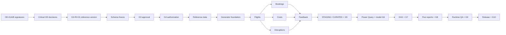

# AEROVISION 360 — Implementation Roadmap

**Status:** ENGINEERING PREPARATION — ROADMAP DESIGNED, NOT AUTHORIZED FOR EXECUTION
**Version:** 0.1
**Prepared:** 2026-11-02
**Governing contract:** `docs/03_DATA_CONTRACTS.md` version 1.5
**Current gate baseline:** G1 `IN PROGRESS`, G2 `PASS`, G3 `NOT STARTED`, G4 `BLOCKED`, G5–G10 `NOT STARTED`
**Project root:** `C:\Users\KHfar\OneDrive\Desktop\AEROVISION_360`

> **Status notice.** This roadmap is a planning artifact. It does not authorize reference data, synthetic data, Python, Power Query, a semantic model, DAX, a report, a dashboard, a release, a Git operation, or a gate change. OD-01A/OD-01B remain `OWNER-CONFIRMED DESIGN — FORMAL SIGNATURE AND APPROVAL PENDING`; `G3-RV-01` is `NOT EXECUTED`; G3 is `NOT STARTED`; G4 is `BLOCKED`; G5–G10 are `NOT STARTED`. No approval date, reviewer identity, or signature is invented.

**Canonical disclosure:** `Synthetic Simulation — Not Actual Airline Performance`

## 1. Purpose

This roadmap converts the nine preparation blueprints into an ordered implementation plan for one developer working with AI assistance. It identifies:

- the mandatory approval and design gates before any data or code;
- the critical path;
- deliverables and acceptance evidence per phase;
- active effort ranges, learning/troubleshooting allowance, and waiting time;
- risks that could invalidate the plan;
- the exact next action and the stop point.

The roadmap is deliberately conservative. It does not promise a delivery date. Estimates are planning ranges, not commitments, and they assume the owner is available for decisions and review.

## 2. Current gate baseline

| Gate | Status | Meaning | Exit requirement |
|---|---|---|---|
| G1 — Environment | `IN PROGRESS` | Python 3.13.2, Power BI Desktop, Excel, and Git detected earlier | Complete environment audit, dependency lock, disk/path review |
| G2 — Scope | `PASS` | Scope baseline exists; OD-01 wording aligned on 2026-11-02 | Maintain traceability; no regression |
| G3 — Data design | `NOT STARTED` | Contract v1.5 and nine blueprints are design evidence, not approval | OD-01A/OD-01B signatures, critical decisions, `G3-RV-01`, schema freeze, G3 review |
| G4 — Data generation | `BLOCKED` | No dataset, reference CSV, or authorization | G3 `APPROVED`, written G4 authorization |
| G5 — Data quality | `NOT STARTED` | No validation evidence | T-01–T-79 applicable tests, zero critical/high defects |
| G6 — Semantic model | `NOT STARTED` | No model | Power Query/model build and T-42–T-44 |
| G7 — DAX reconciliation | `NOT STARTED` | No measures | KPI implementation and T-28–T-39, T-60 |
| G8 — Report | `NOT STARTED` | No report | Five pages and T-45–T-46 |
| G9 — Runtime QA | `NOT STARTED` | No runtime evidence | T-37, T-42–T-46, T-55, T-79, performance/accessibility |
| G10 — Portfolio release | `NOT STARTED` | No release | All gates, disclosure, reproducibility, packaging |

**Invariant:** no phase may skip a gate because the previous phase's documentation looks complete. Design documents are not approvals.

## 3. Estimating approach

**Resource assumption:** one developer working with AI assistance, part-time or full-time, with owner decision latency. AI reduces drafting and boilerplate time, not approval time, independent reconciliation, visual QA, or defect closure.

**Effort categories:**

| Category | Treatment |
|---|---|
| Delivery effort | Active design, build, test, and documentation hours |
| Learning/troubleshooting | 10–15% of delivery effort; new Power BI/Parquet/DAX/time-zone issues |
| Polish | 5–10% of delivery effort; visual refinement, accessibility, wording |
| Approval/waiting | Elapsed calendar time, not active hours |
| Rework | Not estimated as a separate block; controlled by gate reviews and tests |

**Delivery effort range:** 504–744 active hours.
**Learning/troubleshooting:** 60–100 hours.
**Polish:** 32–56 hours.
**Total active planning range:** approximately 596–900 hours.
**Elapsed estimate:** 15–23 weeks at 40 productive hours/week, plus 4–8 weeks of approval/waiting, for approximately 19–31 weeks elapsed. This is not a promised date. A part-time schedule extends elapsed time proportionally.

## 4. Critical path

**Parallel opportunities:** reference validation, report design, and QA fixtures can be prepared in parallel with generator work only after G4 and without publishing data. They do not shorten the approval critical path.

## 5. Phase plan

| Phase | Gate | Objective | Key deliverables | Dependencies | Acceptance evidence | Active hours |
|---|---|---|---|---|---:|
| 0 | G1/G3 readiness | Close governance and environment prerequisites | Signatures; critical OD decisions; `G3-RV-01`; schema freeze; G3 review; G4 authorization; environment lock | Owner availability | Signed records; approved manifest/key map; freeze record; G4 authorization | 16–24 |
| 1 | G3/G5 input | Create and approve reference data | `ref_*` CSVs; provenance register; key map; reference manifest; T-56–T-59, T-72–T-78 | Phase 0 | Approved version; zero identity/reference defects; T-72–T-78 PASSED | 32–48 |
| 2 | G4 | Build generator foundation | Config/schema/utilities; dimensions/network; unit tests; manifest skeleton | Phase 0; reference version | Schema parity; seed/key tests; no data publish | 32–48 |
| 3 | G4/G5 | Generate flight operations | 150,000 flight legs; capacity/status/delay/date keys; T-03–T-18 | Phase 2 | Flight grain/capacity/referential evidence | 32–48 |
| 4 | G4/G5 | Generate bookings | ~16M coupons; fare/channel/customer/refunds; T-19–T-22, T-31, T-53 | Phase 3; OD-14/OD-18 | Coupon-to-flight and revenue controls | 48–72 |
| 5 | G4/G5 | Generate costs, disruptions, feedback | ~1.2M cost lines; ~90k events; ~300k feedback; T-23–T-26, T-36, T-49, T-61–T-64 | Phase 3/4 | Cost/delay/feedback controls | 56–80 |
| 6 | G5 | Build STAGING/CURATED and QA | DQ rules/quarantine; curated star schema; T-01–T-14, T-47–T-54, T-63–T-71 | Phase 3–5 | Zero critical/high defects; G5 review | 64–96 |
| 7 | G6 | Build Power Query and semantic model | Query layer; role copies; model relationships; T-42–T-44 | Phase 6; schema freeze | Model inventory; relationship evidence | 40–56 |
| 8 | G7 | Implement DAX and reconcile KPIs | 21 KPIs; support measures; T-28–T-39, T-60 | Phase 7 | KPI controls; zero-denominator evidence | 40–56 |
| 9 | G8 | Build five report pages | Executive, Network, Revenue, Operations, Customer; drill-through; tooltips; mobile | Phase 8; approved design | Page inventory; T-45–T-46 evidence | 64–96 |
| 10 | G9 | Runtime, disclosure, performance, accessibility QA | T-37, T-42–T-46, T-55, T-79; performance/accessibility | Phase 9 | Runtime evidence; disclosure PASS; no critical/high defects | 56–80 |
| 11 | G10 | Release and portfolio packaging | Case study; setup/readme; release checklist; reproducible package | Phase 10 | G10 approval; no prohibited artifacts | 24–40 |

**Phase 0 is not optional.** The project cannot move to reference data or generation while OD-01A/OD-01B are unsigned or `G3-RV-01` is absent.

## 6. Phase detail

### 6.1 Phase 0 — Governance closure and environment

**Tasks:**

1. Obtain formal OD-01A signature, decision date, owner approval evidence.
2. Obtain formal OD-01B signature, decision date, owner approval evidence.
3. Close critical OD decisions required for G3; record selected option, rejected alternative, rationale, impact, affected requirements, approver, and date.
4. Complete `G3-RV-01`: approve one reference version and manifest.
5. Freeze the schema and record the frozen contract/schema hash.
6. Complete G3 review and record APPROVED or return for rework.
7. Record written G4 authorization.
8. Re-audit Python 3.13.2 environment, package versions, Power BI Desktop version, disk/path, and time-zone database.
9. Assign an independent reviewer for test PASS decisions; if no reviewer, record that limitation and do not mark tests PASSED.

**Acceptance:** signed OD-01A/B; approved `G3-RV-01`; schema freeze; G3 APPROVED; G4 written authorization; environment lock; no open decision that changes population, keys, reference version, facts, dimensions, or KPI definitions.

**Stop condition:** if any signature, critical decision, manifest, or schema freeze is missing, stop before Phase 1.

### 6.2 Phase 1 — Reference data foundation

**Tasks:** create approved reference CSVs, provenance register, key map, manifest, exchange rates, availability, calendar; validate formats, uniqueness, provenance, version, key stability; run T-56–T-59 and T-72–T-78.

**Acceptance:** one approved reference version; ten airlines; zero missing/extra/duplicate identities; every populated attribute has verified provenance or is null; `AirlineId`→`AirlineKey` exact; no mixed version.

**Note:** reference data creation is itself a controlled artifact and requires explicit authorization; this roadmap does not grant it.

### 6.3 Phase 2 — Generator foundation

**Tasks:** configuration, schema registry, IO/hashing/logging/time-zone/ID utilities, dimension/network generators, test fixtures, manifest skeleton.

**Acceptance:** schema parity; deterministic IDs; no `AirlineKey` derivation; path safety; no data published; unit tests implemented and executed.

### 6.4 Phase 3 — Flights

**Tasks:** schedule, aircraft assignment, UTC timestamps, local date keys, capacity, cancellations, delays, on-time flags; T-03–T-18.

**Acceptance:** 150,000–250,000 legs; unique grain; no overbooking; cancelled flights correct; DST/overnight/cross-zone evidence; passenger controls defined.

### 6.5 Phase 4 — Bookings

**Tasks:** demand pools, coupon generation, fare/channel/customer assignment, taxes/fees/ancillary/refunds, booking controls, lead time, allocation; T-19–T-22, T-31, T-53.

**Acceptance:** one coupon per passenger segment; Flown revenue/non-revenue reconcile to flight counts; revenue identities exact; refunds once; booking-level amounts allocated once. T-55 remains BLOCKED until OD-14 is formally approved.

### 6.6 Phase 5 — Costs, disruptions, feedback

**Tasks:** cost ledger and allocation; delay decomposition and cancellation events; feedback sampling and service recovery; T-23–T-26, T-36, T-49, T-61–T-64.

**Acceptance:** cost control totals; delay attribution; reactionary evidence; feedback grain/date/resolution; no unsupported severity/sentiment.

### 6.7 Phase 6 — STAGING, CURATED, and G5

**Tasks:** DQ rules, quarantine/disposition, key resolution, currency, curated publication, full validation; T-01–T-14, T-47–T-54, T-63–T-71.

**Acceptance:** zero critical/high defects; zero duplicate grain/keys; zero orphan required keys; controlled defects detected; G5 review.

### 6.8 Phase 7 — Power Query and semantic model

**Tasks:** query inventory, version validation, role copies, model relationships, hidden keys, hierarchies, measure table; T-42–T-44.

**Acceptance:** clean 1:* single-direction model; no fact-to-fact/M2M; correct date/airport roles; selected version validation; refresh evidence begins.

### 6.9 Phase 8 — DAX and KPI reconciliation

**Tasks:** implement 21 KPIs and supporting measures; zero-denominator tests; independent controls; formats; T-28–T-39, T-60.

**Acceptance:** every KPI definition matches the catalogue/contract; independent control within approved/proposed tolerance; BLANK not zero; K-16/K-20 resolved by owner decision or excluded with a blocker.

### 6.10 Phase 9 — Five report pages

**Tasks:** build the five pages, drill-through, tooltips, bookmarks, navigation, mobile, accessibility; T-45–T-46.

**Acceptance:** five visible pages; KPI cards match; date roles labelled; no incompatible slices; custom tooltip disclosure; no unsupported fields; page inventory.

### 6.11 Phase 10 — Runtime QA and performance

**Tasks:** T-37, T-42–T-46, T-55, T-79; performance, accessibility, export, screenshots; defect closure.

**Acceptance:** T-79 PASS on page/tooltip/export/screenshot; no critical/high defects; runtime interaction acceptable; model size/refresh recorded; disclosure unconditional. T-55 remains BLOCKED unless OD-14 is formally approved; if it is unresolved, Phase 10 cannot be accepted.

### 6.12 Phase 11 — Release and portfolio packaging

**Tasks:** setup/readme, case study, release checklist, reproducibility instructions, artifact inventory, privacy review, final gate review.

**Acceptance:** G10 approved; no PII/secrets; all tests/evidence; no unauthorized artifacts; disclosure present in all release artifacts.

## 7. Effort summary

| Block | Hours |
|---|---:|
| Phase 0 governance/environment | 16–24 |
| Reference data | 32–48 |
| Generator foundation | 32–48 |
| Flights | 32–48 |
| Bookings | 48–72 |
| Costs/disruptions/feedback | 56–80 |
| STAGING/CURATED/QA | 64–96 |
| Power Query/model | 40–56 |
| DAX/KPIs | 40–56 |
| Five dashboards | 64–96 |
| Runtime QA/performance | 56–80 |
| Release/case study | 24–40 |
| **Delivery subtotal** | **504–744** |
| Learning/troubleshooting | 60–100 |
| Polish | 32–56 |
| **Total active planning range** | **596–900** |
| Approval/waiting | 4–8 weeks elapsed |

**Confidence:** low-to-medium until Phase 3 produces real performance and generation data. The largest uncertainty is the 16M-coupon volume and Power BI import/interaction performance, not the document design.

## 8. Dependencies and decision blockers

| Dependency | Blocks | Impact if unresolved |
|---|---|---|
| OD-01A/OD-01B signatures | G3, reference data, all generation | No airline population/identity authorization |
| Critical OD decisions | G3/schema freeze | KPIs, allocations, classifications, date rules remain provisional |
| `G3-RV-01` | Reference data, model refresh | No approved version; mixed-version risk |
| Schema freeze | Power Query/model | Rework, conflicting definitions |
| G4 authorization | Any generation | Unauthorized data creation |
| OD-14 allocation | T-55, booking controls | Allocation evidence cannot be accepted |
| OD-18 eligibility | K-16, K-20, refund definitions | Booking metrics may be wrong |
| OD-22 lead-time policy | K-16 | No approved maximum; avoid enforcing 365 days |
| OD-21 targets | Target variance | No target line/variance may be shown |
| Power BI Desktop/Parquet capability | G6–G9 | Refresh/performance failure |
| Independent reviewer | PASS decisions | Tests remain EXECUTED, not PASSED |
| Git authorization | Version evidence | Hash-only versioning; no commits/branches |

## 9. Risks and mitigations

| Risk | Likelihood | Impact | Mitigation |
|---|---|---|---|
| Owner approval delay | High | Critical path slips | Close signatures/decisions before code; no “provisional” generation |
| Reference provenance is incomplete or conflicting | Medium | G3 cannot close | Quarantine; optional null; no inference; attribute-level evidence |
| 16M coupon rows exceed Power BI Desktop capacity | Medium | Model/report rework | Benchmark early; column pruning; Parquet; approved performance design if needed |
| Power BI Parquet connector/tenant limitations | Medium | Refresh failure | Test in Phase 7; CSV fallback only with documented compatibility |
| Map visual unavailable | Medium | Page 2 gap | Route table/matrix fallback designed |
| K-16/K-20 eligibility ambiguity | High | Wrong customer metrics | Owner decision; booking helper table or measure; exclude with blocker if unresolved |
| Unsupported severity/sentiment asks | High | Scope creep/contract conflict | Mark `OWNER DECISION REQUIRED`; no columns without contract change |
| Disclosure misses tooltips/exports | Medium | Release blocker | Custom tooltips only; export disabled until T-79; screenshot review |
| Time-zone/DST errors | Medium | Date/passenger errors | IANA zones; tz version; boundary tests |
| Allocation/reconciliation defects | Medium | KPI distrust | Independent controls; OD-14; exact residual rules |
| One-person bus factor | High | Delay if unavailable | Documented runbooks; deterministic manifests; reviewer involvement |
| Test evidence fabricated or overstated | Low | Integrity failure | No test PASS without reviewer/evidence; hashes; no invented dates |
| Git prohibition causes version confusion | Medium | Rework | File hashes/manifests; no Git operations until authorized |
| Scope creep during dashboard build | High | Delay | Five pages and 21 KPIs only; changes through decisions |

## 10. First actions after authorization

1. Obtain OD-01A/OD-01B signatures and dates.
2. Record critical OD decisions and update the decision register.
3. Complete `G3-RV-01` and approve the reference manifest/key map.
4. Freeze the schema and record the hash.
5. Obtain G3 approval and G4 written authorization.
6. Lock the Python/Power BI environment and assign a reviewer.
7. Start Phase 1 reference data; do not start with Python or Power BI.

**Do not start with the generator, Power Query, or dashboards.** Those are downstream of approvals and reference data.

## 11. Roadmap acceptance criteria

| ID | Criterion | Evidence |
|---|---|---|
| RM-01 | Every phase has gate, deliverable, dependency, acceptance, and effort | This document |
| RM-02 | Critical path is explicit | Section 4 |
| RM-03 | No phase starts before its gate | Gate review |
| RM-04 | Active effort includes learning/troubleshooting and polish | Section 7 |
| RM-05 | Waiting time is separated from active time | Section 7 |
| RM-06 | No guaranteed date or approval is claimed | Document review |
| RM-07 | Risks and decision blockers are explicit | Sections 8–9 |
| RM-08 | First action is governance, not code | Section 10 |
| RM-09 | No implementation artifact is created by this roadmap | Repository inspection |
| RM-10 | G3/G4 status remains unchanged | Ledger cross-check |

## 12. Document register

The preparation sprint creates exactly nine engineering documents:

1. `docs/ENGINEERING_DATA_MODEL_BLUEPRINT.md`
2. `docs/SYNTHETIC_DATA_GENERATION_BLUEPRINT.md`
3. `docs/PYTHON_ETL_IMPLEMENTATION_BLUEPRINT.md`
4. `docs/POWER_QUERY_IMPLEMENTATION_BLUEPRINT.md`
5. `docs/POWER_BI_SEMANTIC_MODEL_BLUEPRINT.md`
6. `docs/DAX_KPI_CATALOGUE.md`
7. `docs/POWER_BI_DASHBOARD_SPECIFICATION.md`
8. `docs/IMPLEMENTATION_QA_BLUEPRINT.md`
9. `docs/IMPLEMENTATION_ROADMAP.md`

These are design artifacts, not approvals, a schema freeze, or authorization. The only governance document modified in the preparation sprint is `docs/01_PROJECT_SCOPE.md`, with a backup and before/after hash recorded in the final preparation report. All other governance documents remain unchanged.

## 13. Stop point

This roadmap stops at preparation. The next action is the owner's formal approval sequence in Section 10. Until then:

- no reference CSV;
- no synthetic dataset;
- no Python code or execution;
- no Power Query `.m` file;
- no PBIX/PBIP;
- no semantic model;
- no DAX measure;
- no report or dashboard;
- no schema freeze;
- no approval, signature, date, or reviewer invented;
- no Git operation.

**End of roadmap.** This document is design evidence only. It does not authorize implementation or advance any gate.

---

## Portfolio Transition Amendment — A360-PA-001
**Effective direction date:** 2026-11-04  
**Status:** Owner-directed portfolio implementation track

The project may now proceed with controlled portfolio engineering. Historical G3/G4 statuses remain unchanged and must not be represented as approved.

### Revised implementation sequence

1. Establish the airline reference workbook and source register.
2. Build reproducible synthetic-data generation.
3. Implement RAW, STAGING, and CURATED data layers.
4. Build automated data-quality and reconciliation tests.
5. Develop the Power BI dimensional model and Power Query transformations.
6. Implement and validate DAX measures and KPI definitions.
7. Build six dashboards: Executive Overview, Flight Operations, Revenue & Finance, Customer Intelligence, Route & Network Intelligence, and Disruption & Risk Analytics.
8. Complete runtime, data, KPI, and visual QA.
9. Package documentation, reproducibility evidence, limitations, and portfolio outputs.

### Practical implementation checkpoints

- Reference Data QA
- Synthetic Data QA
- Data Pipeline QA
- Semantic Model and KPI QA
- Dashboard QA
- Portfolio Release QA

Each checkpoint requires actual evidence. These checkpoints do not retroactively change formal historical gate statuses.

The project remains a synthetic portfolio simulation, not a production airline system.
