# AEROVISION 360 — Power BI Semantic Model Blueprint

**Status:** ENGINEERING PREPARATION — DESIGNED, NOT IMPLEMENTED; NO PBIX/PBIP OR MODEL
**Version:** 0.1
**Prepared:** 2026-11-02
**Governing contract:** `docs/03_DATA_CONTRACTS.md` version 1.5
**Companion documents:** `ENGINEERING_DATA_MODEL_BLUEPRINT.md`, `POWER_QUERY_IMPLEMENTATION_BLUEPRINT.md`, `DAX_KPI_CATALOGUE.md`
**Project root:** `C:\Users\KHfar\OneDrive\Desktop\AEROVISION_360`

> **Status notice.** This is a proposed semantic-model design. No Power BI model, PBIX, PBIP, relationship, measure, or report has been created. `power_bi/` is empty. G3 is `NOT STARTED`; G4 is `BLOCKED`; schema freeze and Power BI implementation are `NOT AUTHORIZED`.

## 1. Purpose and design goals

The model must provide a clean, unambiguous star schema for the five facts and their conformed dimensions, with explicit DAX measures and traceable values. It must:

- use `AirlineKey` for every airline relationship;
- keep one active date relationship per fact;
- model airport roles explicitly;
- prevent ambiguous `DimAirline` filter paths;
- hide technical keys and lineage columns;
- expose exactly one approved `SelectedReferenceVersion`;
- preserve the exact synthetic disclosure on every page, tooltip, and export;
- avoid many-to-many, bidirectional, and fact-to-fact relationships.

The model is for a portfolio-grade Power BI Desktop project. It is not a production airline system. Cloud deployment, scheduled refresh, and RLS are out of the baseline.

## 2. Model schema

```mermaid
erDiagram
  DimDate ||--o{ FactFlightOperations : "ScheduledDepartureDateKey (active)"
  DimDate ||--o{ FactFlightOperations : "ScheduledArrivalDateKey (inactive)"
  DimDate ||--o{ FactBookingTransactions : "TravelDateKey (active)"
  DimDate ||--o{ FactBookingTransactions : "BookingDateKey (inactive)"
  DimDate ||--o{ FactOperatingCosts : "CostDateKey"
  DimDate ||--o{ FactDisruptions : "EventDateKey"
  DimDate ||--o{ FactCustomerFeedback : "FeedbackDateKey (active)"
  DimDate ||--o{ FactCustomerFeedback : "ResolutionDateKey (inactive)"
  DimAirline ||--o{ FactFlightOperations : "AirlineKey"
  DimAirline ||--o{ FactBookingTransactions : "AirlineKey"
  DimAirline ||--o{ FactOperatingCosts : "AirlineKey"
  DimAirline ||--o{ FactDisruptions : "AirlineKey"
  DimAirline ||--o{ FactCustomerFeedback : "AirlineKey"
  DimRoute ||--o{ FactFlightOperations : "RouteKey"
  DimRoute ||--o{ FactBookingTransactions : "RouteKey"
  DimRoute ||--o{ FactOperatingCosts : "RouteKey"
  DimRoute ||--o{ FactDisruptions : "RouteKey"
  DimRoute ||--o{ FactCustomerFeedback : "RouteKey"
  DimAircraft ||--o{ FactFlightOperations : "AircraftKey"
  DimAircraftType ||--o{ DimAircraft : "AircraftTypeKey"
  "DimAirport - Origin" ||--o{ DimRoute : "OriginAirportKey"
  "DimAirport - Destination" ||--o{ DimRoute : "DestinationAirportKey"
  "DimAirport - Event Location" ||--o{ FactDisruptions : "EventLocationAirportKey"
  DimCustomer ||--o{ FactBookingTransactions : "CustomerKey"
  DimCustomer ||--o{ FactCustomerFeedback : "CustomerKey"
  DimFareClass ||--o{ FactBookingTransactions : "FareClassKey"
  DimBookingChannel ||--o{ FactBookingTransactions : "BookingChannelKey"
  DimDisruptionType ||--o{ FactDisruptions : "DisruptionTypeKey"
  DimCurrency ||--o{ FactBookingTransactions : "TransactionCurrencyKey"
  DimCurrency ||--o{ FactOperatingCosts : "CurrencyKey"
  DimAircraft ||--o{ RefAircraftAvailability : "AircraftKey"
  DimDate ||--o{ RefAircraftAvailability : "CalendarDateKey"
```

**Not shown as active:** `DimAirline → DimAircraft` (lineage only). It must not create a second active filter path to `FactFlightOperations`.

## 3. Tables and visibility

| Table | Type | Load | Report visibility | Notes |
|---|---|---|---|---|
| `DimDate` | Dimension | Yes | Visible | Mark as date table; hide `DateKey` |
| `DimAirline` | Dimension | Yes | Visible | Hide `AirlineKey` and `ReferenceVersion`; `AirlineId` non-slicer lineage only |
| `DimAirport - Origin` | Role dimension | Yes | Visible | Airport role; no relation to other airport roles |
| `DimAirport - Destination` | Role dimension | Yes | Visible | Airport role |
| `DimAirport - Event Location` | Role dimension | Yes | Visible | Event location only |
| `DimRoute` | Dimension | Yes | Visible | Hide `RouteKey`; route labels |
| `DimAircraft` | Dimension | Yes | Visible | Hide `AircraftKey`; fleet labels |
| `DimAircraftType` | Dimension | Yes | Visible | Snowflake to DimAircraft |
| `DimCustomer` | Dimension | Yes | Visible | Hide `CustomerKey`; no PII |
| `DimFareClass` | Dimension | Yes | Visible | Fare labels |
| `DimBookingChannel` | Dimension | Yes | Visible | Channel labels |
| `DimDisruptionType` | Dimension | Yes | Visible | Cause labels |
| `DimCurrency` | Dimension | Yes | Visible | Currency labels |
| `FactFlightOperations` | Fact | Yes | Visible | Hide `FlightOperationKey`; `FlightLegID` for drill-through |
| `FactBookingTransactions` | Fact | Yes | Visible | Hide `BookingTransactionKey`; degenerate booking/ticket fields visible only for detail |
| `FactOperatingCosts` | Fact | Yes | Visible | Hide `OperatingCostKey`; `CostLineID` for drill-through |
| `FactDisruptions` | Fact | Yes | Visible | Hide `DisruptionKey`; `DisruptionID` for detail |
| `FactCustomerFeedback` | Fact | Yes | Visible | Hide `FeedbackKey`; `FeedbackID` for detail |
| `RefAircraftAvailability` | Reference | Yes | Hidden | K-13 denominator only; not a fact |
| `_SelectedReferenceVersion` | Parameter table | Yes | Hidden | One row; selected version |
| `_Measures` | Measure table | Yes | Visible | Empty table for measures; display folders |
| `ModelValidation` | Validation | No | Hidden | Connection-only; refresh check |
| `RefManifest` | Reference | No | Hidden | Connection-only approval check |
| `RefAirlineSources` | Reference | No | Hidden | Connection-only provenance evidence |

**Hidden columns:** all surrogate keys, all technical lineage columns, `ReferenceVersion`, `SourceFile`, `SourceRowNumber`, `IngestedAtUTC`, `QualityStatus`, and any internal hash. `AirlineId` may remain as a non-slicer lineage attribute; hide it from the report view if it would be confused with a key. `BusinessModelClass` may remain visible but must be labelled `Analytical classification (optional)`.

## 4. Relationships

| From | To | Key | Cardinality | Filter | Active | Cross-filter |
|---|---|---|---|---|---|---|
| `DimDate` | `FactFlightOperations` | `ScheduledDepartureDateKey` | 1:* | Single | Yes | One direction |
| `DimDate` | `FactFlightOperations` | `ScheduledArrivalDateKey` | 1:* | Single | No | One direction |
| `DimDate` | `FactBookingTransactions` | `TravelDateKey` | 1:* | Single | Yes | One direction |
| `DimDate` | `FactBookingTransactions` | `BookingDateKey` | 1:* | Single | No | One direction |
| `DimDate` | `FactOperatingCosts` | `CostDateKey` | 1:* | Single | Yes | One direction |
| `DimDate` | `FactDisruptions` | `EventDateKey` | 1:* | Single | Yes | One direction |
| `DimDate` | `FactCustomerFeedback` | `FeedbackDateKey` | 1:* | Single | Yes | One direction |
| `DimDate` | `FactCustomerFeedback` | `ResolutionDateKey` | 1:* | Single | No | One direction |
| `DimAirline` | All five facts | `AirlineKey` | 1:* | Single | Yes | One direction |
| `DimRoute` | All five facts | `RouteKey` | 1:* | Single | Yes | One direction |
| `DimAircraft` | `FactFlightOperations` | `AircraftKey` | 1:* | Single | Yes | One direction |
| `DimAircraftType` | `DimAircraft` | `AircraftTypeKey` | 1:* | Single | Yes | One direction |
| `DimAirport - Origin` | `DimRoute` | `OriginAirportKey` | 1:* | Single | Yes | One direction |
| `DimAirport - Destination` | `DimRoute` | `DestinationAirportKey` | 1:* | Single | Yes | One direction |
| `DimAirport - Event Location` | `FactDisruptions` | `EventLocationAirportKey` | 1:* | Single | Yes | One direction |
| `DimCustomer` | `FactBookingTransactions` | `CustomerKey` | 1:* | Single | Yes | One direction |
| `DimCustomer` | `FactCustomerFeedback` | `CustomerKey` | 1:* | Single | Yes | One direction |
| `DimFareClass` | `FactBookingTransactions` | `FareClassKey` | 1:* | Single | Yes | One direction |
| `DimBookingChannel` | `FactBookingTransactions` | `BookingChannelKey` | 1:* | Single | Yes | One direction |
| `DimDisruptionType` | `FactDisruptions` | `DisruptionTypeKey` | 1:* | Single | Yes | One direction |
| `DimCurrency` | `FactBookingTransactions` | `TransactionCurrencyKey` | 1:* | Single | Yes | One direction |
| `DimCurrency` | `FactOperatingCosts` | `CurrencyKey` | 1:* | Single | Yes | One direction |
| `DimAirline` | `DimAircraft` | `AirlineKey` | 1:* | Single | No | One direction |
| `DimDate` | `RefAircraftAvailability` | `CalendarDateKey` | 1:* | Single | Yes | One direction |
| `DimAircraft` | `RefAircraftAvailability` | `AircraftKey` | 1:* | Single | Yes | One direction |

**Prohibited relationships:**

- Any fact-to-fact relationship (`FactBookingTransactions` → `FactFlightOperations`, etc.).
- Any many-to-many or bidirectional relationship.
- An active `DimAirline` → `DimAircraft` path while `DimAirline` also filters `FactFlightOperations`.
- More than one active `DimDate` relationship per fact.
- Direct `DimAirport` → fact and role-copy paths that create ambiguity.
- Any relationship on `AirlineId`, IATA, ICAO, or name.

## 5. Date model

- Mark `DimDate` as the model date table using `FullDate`.
- Disable Auto date/time for every table.
- Create a Calendar hierarchy: `Year` → `Quarter` → `MonthName` → `FullDate`.
- Create a Fiscal hierarchy: `FiscalYear` → `FiscalQuarter` → `FiscalMonthNumber`.
- Sort `MonthName` by `MonthNumber`; `DayName` by `DayOfWeekNumber`; `YearMonth` by `YearMonthSort`.
- Use `USERELATIONSHIP` only for documented inactive date roles: arrival, booking date, feedback resolution.
- The default date role is the active relationship on each fact. A measure must state its date role when it uses an inactive role.
- Period-boundary logic: a flight departing 2026-09-30 and arriving 2026-10-01 belongs to the period by departure date; the arrival date remains in DimDate.
- `IsReportingPeriod` is the standard page filter for the fixed 12-month baseline. Prior-period comparisons may use the full DimDate range.

## 6. Airline, airport, and fleet roles

### 6.1 Airline

- `DimAirline` filters all five facts on `AirlineKey`.
- `AirlineKey` and `ReferenceVersion` are hidden.
- `AirlineId` is a durable identity attribute, not a slicer and not a relationship key.
- Do not add `LegalName`, `OperatingRegion`, `LifecycleStatus`, or `MergedIntoAirlineId`.
- `BusinessModelClass` is optional analytical, null-allowed, and labelled as analytical.
- Exactly one `SelectedReferenceVersion` is exposed; `DimAirline.ReferenceVersion` must equal it for every row.

### 6.2 Airport roles

- `DimAirport - Origin` and `DimAirport - Destination` relate to `DimRoute`.
- `DimAirport - Event Location` relates directly to `FactDisruptions`.
- The physical `DimAirport` is not related to facts; it is the source for role copies.
- Do not activate two relationships from one airport table to `DimRoute`.
- Origin/destination filters should not automatically filter event-location analysis; the roles are independent.

### 6.3 Fleet

- `DimAircraft` filters `FactFlightOperations` on `AircraftKey`.
- `DimAircraftType` filters `DimAircraft` as a snowflake.
- `DimAirline → DimAircraft` is inactive/lineage only.
- For airline-level aircraft utilization and fleet counts, use a documented `TREATAS` measure that transfers the `DimAirline[AirlineKey]` filter to `DimAircraft[AirlineKey]`. Do not activate the physical relationship.
- `RefAircraftAvailability` is a supporting reference table, not a fact. It relates to `DimAircraft` and `DimDate`; it must not multiply `FactFlightOperations`.

## 7. Measures and display

### 7.1 Measure table and naming

- Use one `_Measures` table with display folders:
  - `01 Capacity`
  - `02 Revenue`
  - `03 Cost and Contribution`
  - `04 Operations`
  - `05 Customer`
  - `06 Supporting`
  - `07 Scenario`
  - `08 Validation`
- Measure names are business-facing and unique. Prefix internal helpers with `_` and hide them.
- Every ratio uses `DIVIDE` and returns BLANK for zero/missing denominators.
- Every financial measure uses USD columns; no DAX currency conversion.
- Every ratio tooltip shows its denominator/response count.
- No measure may use `SUMX` over a dimension to allocate a fact.
- No measure may use `RELATED` to pull a dimension value into a fact measure.

### 7.2 Formatting conventions

| Measure type | Format |
|---|---|
| Count | `#,##0` |
| Money USD | `$#,##0.00` |
| Percentage | `0.0%` |
| Ratio/unit | `0.0000` |
| ASK/RPK | `#,##0` |
| Delay minutes | `#,##0` |
| Days | `0.0` |
| Currency rate | `0.000000` |

### 7.3 Core measure groups

| Folder | Measures (proposed names) |
|---|---|
| Capacity | `ASK`, `RPK`, `Load Factor`, `Revenue Passengers`, `Available Seats`, `Scheduled Flights`, `Operated Flights` |
| Revenue | `Net Passenger Revenue USD`, `Net Fee Revenue USD`, `Net Ancillary Revenue USD`, `Total Operating Revenue USD`, `Passenger Yield`, `Passenger RASK`, `Total RASK`, `Average Passenger Revenue`, `Ancillary Revenue per Passenger` |
| Cost and Contribution | `Operating Cost USD`, `CASK`, `Unit Contribution`, `Cost per Flight` |
| Operations | `On-Time Performance`, `S-03 On-Time Arrival %`, `Cancellation Rate`, `Completion Rate`, `Average Arrival Delay`, `Aircraft Utilization`, `S-05 Disruption Rate`, `S-06 Reactionary Delay Share`, `S-04 Delay Minutes per Operated Flight` |
| Customer | `Satisfaction`, `Period Complaint Rate`, `Refund Rate`, `Booking Lead Time`, `Repeat Booking Rate`, `Service Recovery Rate`, `Feedback Volume` |
| Supporting | `Revenue Growth %`, `Cost Growth %`, `Ancillary Revenue Share`, `Booking Channel Mix`, `Fare Class Mix`, `Route Contribution`, `Airline Ranking`, `Route Ranking`, `Scheduled vs Operated` |
| Scenario | `Fare Scenario Revenue`, `Capacity Scenario ASK`, `Fuel Scenario Cost`, `Scenario Delta` |
| Validation | `Row Count`, `Selected Version`, `Reference Version Match`, `Disclosure Present` (report-level check, not a data measure) |

The exact DAX proposals and definitions are in `DAX_KPI_CATALOGUE.md`. No measure is executed or validated by this document.

## 8. Hierarchies, sort, and display

| Table | Hierarchy / sort |
|---|---|
| DimDate | Calendar: Year → Quarter → Month → FullDate; Fiscal: FiscalYear → FiscalQuarter → FiscalMonthNumber |
| DimAirport roles | Region → Country → City → AirportCode |
| DimRoute | RouteRegion → RouteCode |
| DimAircraftType | AircraftCategory → Manufacturer → AircraftModel |
| DimFareClass | CabinClass → DisplayOrder → FareClassCode |
| DimCustomer | CustomerSegment → LoyaltyTier (no personal labels) |
| DimDisruptionType | DisruptionCategory → DisruptionName |

- Set data categories: Country, City, Latitude, Longitude on airport roles; `TimeZoneIANA` is descriptive, not date/time.
- Set `Do Not Summarize` on all keys, codes, names, and dates.
- Set numeric fact columns to `Sum` only when they are additive at the declared grain; otherwise hide or use measures.
- Do not create calculated columns that duplicate fact measures. Use measures for ratios.
- Do not expose raw timestamps as axis labels; use DimDate.

## 9. Report interactions and model features

| Feature | Design |
|---|---|
| Navigation | Left rail with five page buttons: Executive, Network, Revenue, Operations, Customer. Current page highlighted. |
| Slicers | Airline, date/period, route region, airport role, fare class, channel, aircraft type. Sync airline/date/region across pages. |
| Drill-through | Hidden pages: `DRL-Airline`, `DRL-Route`, `DRL-Flight`, `DRL-Feedback`. Pass `AirlineKey`, `RouteKey`, `FlightOperationKey`, or `FeedbackKey` as appropriate. |
| Tooltips | Custom report-page tooltips only; each includes the exact synthetic disclosure. Default tooltips are disabled because they cannot guarantee the disclosure. |
| Bookmarks | `Reset filters`, `Definitions`, `Scenario assumptions`, `Data notes`. |
| Field parameters | Optional metric selector on Executive/Network; only approved measures; label the selected measure. |
| What-if | Fare change, capacity change, fuel-cost change; transparent formulas, baseline, assumptions, limitations; no writeback, no forecast claim. |
| Export | Disabled until the export template includes the exact disclosure and T-79 passes. |
| Mobile | Portrait layout with KPI cards stacked, one chart per row, filters collapsed, disclosure visible. |
| Accessibility | Alt text on visuals, tab order, high contrast, labels not color-only, minimum 11 pt text, keyboard navigation. |

### 9.1 Drill-through pages

These are supporting pages, not additions to the five required report pages.

| Page | Source visual | Fields passed | Content |
|---|---|---|---|
| `DRL-Airline` | Airline ranking/bar | `AirlineKey` | Airline KPI cards, route table, monthly trend, disclosure |
| `DRL-Route` | Route table/map | `RouteKey` | Route KPIs, airline comparison, delay/cost context, disclosure |
| `DRL-Flight` | Flight detail table | `FlightOperationKey` | Flight timestamps, status, passengers, delay events, disclosure |
| `DRL-Feedback` | Feedback table | `FeedbackKey` | Feedback detail, resolution, disclosure |

### 9.2 Tooltip and disclosure rule

Every custom tooltip page must contain the exact string `Synthetic Simulation — Not Actual Airline Performance` in a persistent footer. A visual that cannot use a custom tooltip must have tooltips disabled and the values exposed in a side panel. No default tooltip may be shipped without the disclosure. T-79 must verify rendered screenshots, Unicode code points, tooltip visibility, and export metadata.

## 10. Reference version and model validation

- `_SelectedReferenceVersion` is a hidden one-row table with one text column.
- `DimAirline.ReferenceVersion` must equal the selected version for every row.
- `RefAircraftAvailability.ReferenceVersion` must equal the selected version for every row.
- The manifest must show exactly one current `APPROVED` version.
- `AirlineKey` must match the approved key map exactly; no orphan fact key.
- `ModelValidation` is connection-only and raises an error on mismatch. The refresh must fail rather than publish a mixed-version model.
- `DimAirline.ReferenceVersion` is technical lineage, not approval. Do not show it as a report filter.

## 11. Security and row-level security

- RLS is not part of the baseline. No security requirement or access scenario is approved.
- If RLS is added later, secure `DimAirline` and test all five pages plus drill-through. Do not invent roles or test results.
- The model contains no real passenger personal data. Do not add free-text comments or identifiers without a privacy review.
- Do not store credentials or connection secrets in the model or repository.

## 12. Performance and model size

- The planning volume is ~16M coupon rows; this is a performance risk for Power BI Desktop import.
- Use Parquet, column pruning, and a star schema; avoid wide fact tables and unnecessary calculated columns.
- Measure refresh duration, model size, visual interaction time, and memory before full-volume acceptance.
- If performance is unacceptable, do not silently sample or aggregate detail facts. Propose an approved aggregation/performance design with a new schema decision.
- `DimAirport` role copies and `RefAircraftAvailability` add size; measure their impact.
- No aggregation tables, composite models, DirectQuery, or incremental refresh are in the baseline. They require an approved design change.

## 13. What-if scenarios

Proposed parameters and measures:

| Parameter | Range | Measure |
|---|---|---|
| `FareChangePct` | −20% to +20% | `Fare Scenario Revenue = [Total Operating Revenue USD] * (1 + FareChangePct)`; label passenger revenue only if applied to fares |
| `CapacityChangePct` | −10% to +20% | `Capacity Scenario ASK = [ASK] * (1 + CapacityChangePct)`; demand/load-factor assumption must be explicit |
| `FuelCostChangePct` | −30% to +30% | `Fuel Scenario Cost = [Operating Cost USD] + [Fuel Cost USD] * FuelCostChangePct` |

Rules: scenarios are report-layer calculations, not facts; no writeback; no forecast claim; show baseline, assumptions, formula, and limitations; do not use scenario outputs in target variance or official KPIs. Capacity scenarios must not silently change RPK; state the demand assumption.

## 14. Synthetic disclosure

- Persistent header/footer on all five pages and all drill-through pages.
- Exact text: `Synthetic Simulation — Not Actual Airline Performance`.
- Unicode code points: `S` `y` `n` `t` `h` `e` `t` `i` `c` space `S` `i` `m` `u` `l` `a` `t` `i` `o` `n` space em dash space `N` `o` `t` space `A` `c` `t` `u` `a` `l` space `A` `i` `r` `l` `i` `n` `e` space `P` `e` `r` `f` `o` `r` `m` `a` `n` `c` `e`.
- No hyphen variant, no “where practical” exception, no conditional visibility.
- Every custom tooltip and export template must include it.
- T-79 is `BLOCKED` until a rendered report exists; do not claim it passed.

## 15. Acceptance criteria for the model

| ID | Criterion | Evidence |
|---|---|---|
| SM-01 | Five facts and required dimensions are present | Model inventory |
| SM-02 | All relationships are 1:* single-direction | T-42 |
| SM-03 | No fact-to-fact, M2M, or bidirectional relationship | T-44 |
| SM-04 | Date roles and airport roles behave correctly | T-43 |
| SM-05 | AirlineKey is the only airline relationship key | Model review |
| SM-06 | ReferenceVersion is hidden and one version is selected | T-78 |
| SM-07 | Technical keys/lineage hidden | Model review |
| SM-08 | Measure formats and denominators are correct | T-37, T-46 |
| SM-09 | Disclosure is present on pages/tooltips/exports | T-79 |
| SM-10 | Refresh succeeds at target volume | T-45 |
| SM-11 | No PBIX/PBIP or model is claimed before creation | Repository inspection |

## 16. Open decisions and risks

- Formal OD-01A/OD-01B signatures and `G3-RV-01`.
- Critical OD decisions, especially OD-02/OD-03 populations, OD-04 rates, OD-05 capacity, OD-09 OTP, OD-10 availability, OD-12 complaint rate, OD-13 classification, OD-14 allocation, OD-18 eligibility, OD-20 tolerance, OD-21 targets.
- Power BI Desktop version and Parquet connector capability must be verified before implementation.
- Volume/performance at ~16M coupons is unproven.
- The contract has no severity, sentiment, or service-category columns; do not add them.
- The contract rejects a separate `FactRevenue`; revenue remains in `FactBookingTransactions`.
- The synthetic disclosure requirement is unconditional; if export or tooltip cannot meet it, disable that feature rather than weakening the requirement.

## 17. Verification checklist for this blueprint

| Check | Status |
|---|---|
| Clean star schema and five facts | DOCUMENTED |
| Relationship cardinality/filter/active roles | DOCUMENTED |
| No ambiguous airline/airport/date paths | DOCUMENTED |
| AirlineKey and ReferenceVersion rules | DOCUMENTED |
| Hidden technical columns | DOCUMENTED |
| Measure table, folders, formats | DOCUMENTED |
| Drill-through, tooltips, disclosure | DOCUMENTED |
| RLS boundary | DOCUMENTED — not baseline |
| No PBIX/PBIP/model created | VERIFIED BY ABSENCE |
| Power BI implementation authorization | NOT GRANTED |

**End of blueprint.** This document is design evidence only. It does not create or freeze a semantic model, execute DAX, build a report, or advance a gate.
