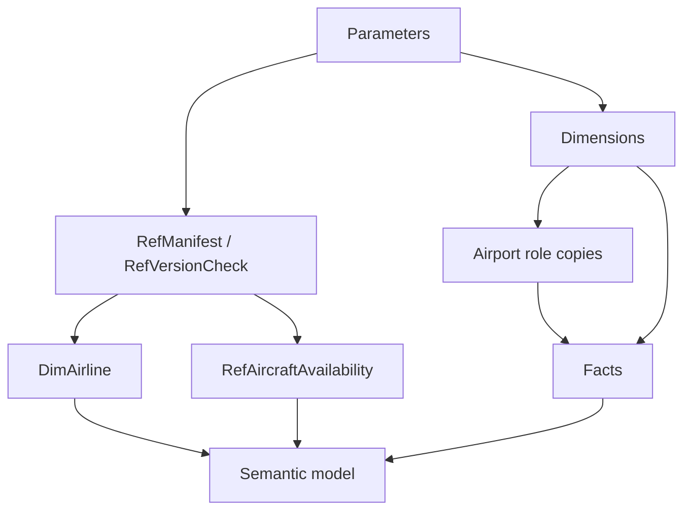

# AEROVISION 360 — Power Query Implementation Blueprint

**Status:** ENGINEERING PREPARATION — DESIGNED, NOT IMPLEMENTED; NO .m FILES OR POWER BI MODEL
**Version:** 0.1
**Prepared:** 2026-11-02
**Governing contract:** `docs/03_DATA_CONTRACTS.md` version 1.5
**Companion documents:** `ENGINEERING_DATA_MODEL_BLUEPRINT.md`, `POWER_BI_SEMANTIC_MODEL_BLUEPRINT.md`
**Project root:** `C:\Users\KHfar\OneDrive\Desktop\AEROVISION_360`

> **Status notice.** This is a proposed Power Query specification. No Power Query query, .m file, Power BI model, PBIX/PBIP, or dataset has been created. `power_bi/` is empty. G3 is `NOT STARTED`; G4 is `BLOCKED`; schema freeze and Power BI implementation are `NOT AUTHORIZED`.

**Canonical disclosure:** `Synthetic Simulation — Not Actual Airline Performance`

## 1. Purpose and boundary

Power Query is the ingestion and shape layer between CURATED/reference files and the Power BI semantic model. It must:

- read only CURATED tables and approved reference tables;
- enforce the contract schema and types;
- preserve nulls and fail on invalid data;
- select only model-required columns;
- create the explicit airport role copies;
- expose the selected reference version and validate it against the manifest;
- avoid re-implementing business transformations already completed in Python.

Power Query must not:

- generate data;
- assign `AirlineKey` or any other business key;
- recalculate revenue, cost, allocation, currency conversion, or delay attribution;
- deduplicate or coerce invalid records silently;
- join facts to facts;
- create a second revenue fact;
- add unsupported columns such as severity, sentiment, or service category;
- write back to the source.

## 2. Source layout

| Source | Format | Query use |
|---|---|---|
| `data/03_curated/<run_id>/dim_*.parquet` | Parquet | Dimensions |
| `data/03_curated/<run_id>/fact_*.parquet` | Parquet | Facts |
| `data/04_reference/ref_aircraft_availability.csv` | CSV, UTF-8 no BOM | K-13 denominator |
| `data/manifests/reference_versions.csv` | CSV | Reference-version approval check |
| `data/manifests/<run_id>/run_manifest.json` | JSON | Run/reference/key-map lineage (connection-only) |

The model imports only CURATED and approved reference data. It does not import RAW or STAGING. The Power Query layer is not a data-quality remediation tool; invalid data must be fixed upstream.

## 3. Parameters and helper queries

| Query | Kind | Type | Purpose | Load |
|---|---|---|---|---|
| `ProjectRoot` | Parameter | Text | Project root path | No |
| `Environment` | Parameter | Text | `DEV`, `TEST`, or `PROD` | No |
| `SelectedReferenceVersion` | Parameter | Text | Exactly one `AIR-YYYY-MM-DD-NNN` version | No |
| `ReportingPeriodStart` | Parameter | Date | `2025-10-01` | No |
| `ReportingPeriodEnd` | Parameter | Date | `2026-09-30` | No |
| `ManifestPath` | Parameter | Text | Reference manifest path | No |
| `fnReadCsv` | Function | Text → Table | Read UTF-8 CSV | No |
| `fnReadParquet` | Function | Text → Table | Read Parquet | No |
| `fnRequireColumns` | Function | Table, list → Table | Fail if required columns are missing | No |
| `fnUtcDateTime` | Function | Text → DateTime | Parse ISO UTC text and remove zone for contract DateTime | No |
| `RefManifest` | Query | Table | Approved reference manifest | Connection only |
| `RefVersionCheck` | Query | Table | Validate version/manifest consistency; error on mismatch | Connection only |
| `_SelectedReferenceVersion` | Query | One-row table | Expose the selected version in the model | Yes, hidden |
| `ModelValidation` | Query | Table | Key/count/version checks; error on failure | Connection only |
| `RefAirlineSources` | Query | Table | Provenance evidence, not report data | Connection only |

### 3.1 Proposed representative M expressions

These are proposals, not production .m files.

```m
// Parameter
SelectedReferenceVersion = "AIR-YYYY-MM-DD-NNN" meta [IsParameterQuery=true, Type="Text", IsParameterQueryRequired=true]

// Read a UTF-8 CSV without BOM
fnReadCsv = (path as text) as table =>
    Csv.Document(
        File.Contents(path),
        [Delimiter = ",", Encoding = 65001, QuoteStyle = QuoteStyle.Csv]
    );

// Fail if required columns are missing
fnRequireColumns = (source as table, required as list) as table =>
    let
        missing = List.Difference(required, Table.ColumnNames(source)),
        checked = if List.IsEmpty(missing) then source else error "Missing required columns: " & Text.Combine(missing, ", ")
    in
        checked;

// Parse contract UTC text as DateTime
fnUtcDateTime = (value as nullable text) as nullable datetime =>
    if value = null then null
    else DateTimeZone.RemoveZone(DateTimeZone.FromText(value));
```

### 3.2 Reference-version validation

`RefVersionCheck` must verify:

1. The manifest contains exactly one `IsCurrent = TRUE` row.
2. That row has `Status = "APPROVED"`.
3. Its `ReferenceVersion` equals `SelectedReferenceVersion`.
4. `RefAirlines` has exactly one distinct `ReferenceVersion`, equal to the selected version.
5. `DimAirline` has exactly 10 active `AirlineId` values and 10 unique `AirlineKey` values.
6. `RefAircraftAvailability` has exactly one distinct `ReferenceVersion`, equal to the selected version.
7. The key-map hash recorded in the run manifest matches the approved key map.

A mismatch raises an error and blocks refresh. The query must not silently choose one version.

## 4. Query catalogue

### 4.1 Dimensions

| Query | Source | Required columns | Transformations | Load | Depends on | Validation |
|---|---|---|---|---|---|---|
| `DimDate` | `dim_date.parquet` | All contract Section 6.2.1 columns | Type enforcement; sort-column checks; date table marker in model | Yes | — | 761 rows; no gaps/duplicates; reporting flag |
| `DimAirline` | `dim_airline.parquet` | `AirlineKey`, `AirlineId`, IATA, ICAO, name, group, country, code, business model, active, status date, reference version | Type enforcement; trim; uppercase codes; filter `ReferenceVersion = SelectedReferenceVersion`; no dedupe | Yes | `SelectedReferenceVersion` | Exactly 10 active; unique keys/IDs; version match |
| `DimAirport` | `dim_airport.parquet` | All contract Section 6.2.3 columns | Type enforcement; trim; validate code/coordinates; keep all airports | Yes | — | Unique code; valid IANA zone |
| `DimRoute` | `dim_route.parquet` | All contract Section 6.2.4 columns | Type enforcement; trim; keep all routes | Yes | `DimAirport` roles | Unique directional route; positive distance |
| `DimAircraft` | `dim_aircraft.parquet` | All contract Section 6.2.5 columns | Type enforcement; keep all fleet statuses | Yes | — | Unique registration; capacity positive |
| `DimAircraftType` | `dim_aircraft_type.parquet` | All contract Section 6.2.6 columns | Type enforcement; keep generic types | Yes | — | Unique manufacturer/model |
| `DimCustomer` | `dim_customer.parquet` | All contract Section 6.2.7 columns | Type enforcement; no PII; keep all | Yes | — | Unique synthetic customer ID |
| `DimFareClass` | `dim_fare_class.parquet` | All contract Section 6.2.8 columns | Type enforcement; sort by display order | Yes | — | Unique code; cabin values |
| `DimBookingChannel` | `dim_booking_channel.parquet` | All contract Section 6.2.9 columns | Type enforcement; direct flag | Yes | — | Unique code/name |
| `DimDisruptionType` | `dim_disruption_type.parquet` | All contract Section 6.2.10 columns | Type enforcement; keep active taxonomy | Yes | — | Unique code/name; flags |
| `DimCurrency` | `dim_currency.parquet` | All contract Section 6.2.11 columns | Type enforcement; USD reporting row | Yes | — | Exactly one USD reporting currency |

**Dimension rules:**

- Do not remove inactive members; reports may need historical context.
- Do not replace nulls with placeholders. `AirlineGroup`, `BusinessModelClass`, and `StatusEffectiveDate` may be null under their rules.
- Do not create a new `OperatingRegion` column. Analytical region comes from `DimAirport`/`DimRoute`.
- Do not create a standalone airline registry or a code-based key.
- Do not deduplicate silently. A duplicate is a validation failure.

### 4.2 Airport role copies

| Query | Source | Purpose | Relationship |
|---|---|---|---|
| `DimAirport - Origin` | Reference `DimAirport` | Origin airport role | Active to `DimRoute.OriginAirportKey` |
| `DimAirport - Destination` | Reference `DimAirport` | Destination airport role | Active to `DimRoute.DestinationAirportKey` |
| `DimAirport - Event Location` | Reference `DimAirport` | Disruption event location role | Active to `FactDisruptions.EventLocationAirportKey` |

The physical `DimAirport` query is not related directly to facts. Role copies are separate model tables; they must not be related to each other. This is required to avoid ambiguous filter paths and two active airport relationships to the same table.

### 4.3 Facts

| Query | Source | Required columns | Transformations | Load | Depends on | Validation |
|---|---|---|---|---|---|---|
| `FactFlightOperations` | `fact_flight_operations.parquet` | Contract Section 6.3.1 columns | Type enforcement; UTC datetime parsing; select model columns; no row-level business recalculation | Yes | Dimensions | Grain unique; FKs resolve; flags consistent |
| `FactBookingTransactions` | `fact_booking_transactions.parquet` | Contract Section 6.3.2 columns | Type enforcement; UTC/date keys; select model columns; no revenue recalculation | Yes | Dimensions, `FactFlightOperations`? No physical relationship | Coupon grain; revenue identities already stored; FKs resolve |
| `FactOperatingCosts` | `fact_operating_costs.parquet` | Contract Section 6.3.3 columns | Type enforcement; select model columns; no allocation/currency recalculation | Yes | Dimensions | Ledger grain; cost classification check upstream |
| `FactDisruptions` | `fact_disruptions.parquet` | Contract Section 6.3.4 columns | Type enforcement; UTC datetime parsing; select model columns; no delay recalculation | Yes | Dimensions | Event sequence; delay partition upstream |
| `FactCustomerFeedback` | `fact_customer_feedback.parquet` | Contract Section 6.3.5 columns | Type enforcement; UTC/date keys; select model columns; no score transformation | Yes | Dimensions | Feedback grain; resolution date rule |

**Fact rules:**

- `FlightOperationKey` in booking/cost/disruption/feedback is loaded as a column for lineage but is not a model relationship.
- `RouteKey` and `AirlineKey` remain denormalized in each fact for direct dimension filtering without a fact-to-fact path.
- Do not filter facts by a single date column in Power Query if that would drop downstream events. The CURATED run is scoped to in-period flights; the model uses the active date role and `DimDate[IsReportingPeriod]`.
- `FactBookingTransactions` is a travel-period snapshot: coupons have `TravelDateKey` in the reporting period; booking dates may precede it.
- Do not compute `NetPassengerRevenueUSD` in Power Query. It is stored in CURATED and must reconcile upstream.
- Do not replace missing satisfaction scores with zero.
- Do not add severity, sentiment, or service-category columns.

### 4.4 Reference and support

| Query | Source | Purpose | Load | Validation |
|---|---|---|---|---|
| `RefAircraftAvailability` | `ref_aircraft_availability.csv` | K-13 available-hours denominator | Yes, hidden from report view | Composite key unique; version match; status/hours rules |
| `RefAirlines` | `ref_airlines.csv` | Optional cross-check only; DimAirline is the model dimension | Connection only | 10 rows; version match; code/name uniqueness |
| `RefAirlineSources` | `ref_airline_sources.csv` | Provenance evidence | Connection only | One VERIFIED record per populated attribute upstream |
| `RefCostClassification` | `ref_cost_classification.csv` | Lineage/validation only | Connection only | Exact category/subcategory match upstream |
| `RefDisruptionTypes` | `ref_disruption_types.csv` | Lineage/validation only | Connection only | Exact type match upstream |
| `RefExchangeRates` | `ref_exchange_rates.csv` | Lineage/validation only | Connection only | Exact-date rate coverage upstream |
| `RefManifest` | `reference_versions.csv` | Approval/version check | Connection only | Exactly one current APPROVED version |
| `RefVersionCheck` | Derived | Fail-closed version check | Connection only | Must return one valid row or error |
| `_SelectedReferenceVersion` | Derived one-row table | Model parameter for selected version | Yes, hidden | Single value |
| `ModelValidation` | Derived | Key/count/version checks | Connection only | Error on failure |

`RefAircraftAvailability` relationship: `DimAircraft[AircraftKey]` 1:* and `DimDate[DateKey]` 1:* to the reference table. It must not relate to `FactFlightOperations`; the measure uses the aircraft/date filter context and the selected version.

## 5. Data-type enforcement

Use explicit types, not detected types:

| Concept | Power Query type | Notes |
|---|---|---|
| Surrogate keys | Int64.Type or Int32.Type | Preserve exact key values; do not convert to text |
| Business keys/codes | Text.Type | Trim; uppercase where contract requires |
| Date | Date.Type | No locale text |
| UTC timestamp | DateTime.Type | Parse ISO text, remove zone offset; contract stores UTC |
| Money USD | Currency.Type or Decimal.Type | Two decimals; use fixed locale |
| Rate/ratio | Decimal.Type | Six decimals |
| Boolean | Logical.Type | Never `Y`/`N` |
| Nullable fields | Nullable type | Preserve null |

The model must not use `Table.TransformColumnTypes` with locale-dependent date parsing. Use ISO conversion helpers and fail on invalid values.

## 6. Error handling and null policy

- **Missing required column:** fail with a clear error.
- **Type conversion failure:** fail; do not replace with null or zero.
- **Duplicate dimension key:** fail; do not deduplicate silently.
- **Unresolved relationship key:** fail at refresh; do not create an unknown member.
- **Reference version mismatch:** fail; do not select a fallback version.
- **Unapproved manifest:** fail; do not load reference data.
- **Null optional value:** preserve; do not display `N/A` in the data layer.
- **Unexpected null required value:** fail; do not impute.
- **Unsupported column:** do not load it into the model; raise a design change if a report requires it.

Power Query should use `error` for fail-closed conditions, not `try ... otherwise` to hide them. A user-facing report may show a controlled message only after the failure is logged and the model is not published.

## 7. Python vs Power Query responsibility split

| Responsibility | Python | Power Query |
|---|---|---|
| Reference approval/version validation | Primary control | Secondary fail-closed check |
| Synthetic data generation | Yes | No |
| RAW preservation | Yes | No |
| Staging standardization/quarantine | Yes | No |
| Key resolution | Yes | No |
| AirlineKey/key-map assignment | Yes | No |
| Currency conversion | Yes | No |
| Revenue/cost allocation | Yes | No |
| Delay attribution | Yes | No |
| Business-rule validation | Yes | No |
| Schema/type enforcement at import | Source schema | Yes |
| Column pruning | Source design | Yes |
| Role-playing airport copies | No | Yes |
| Reference-version parameter exposure | Manifest | Yes |
| Model measures | No | No (DAX) |
| Report visuals | No | No (report layer) |

**Rule:** if a transformation changes a business value, it belongs in Python and must be reconciled. Power Query only shapes data for the model. This prevents two conflicting definitions and makes the DAX layer auditable.

## 8. Query dependencies



The exact load order is: parameters → manifest/version check → dimensions → airport role copies → facts → reference availability → validation. A failure at any upstream step blocks downstream load.

## 9. Refresh and deployment behavior

- The model uses a single `SelectedReferenceVersion` parameter. A refresh with a different version must be a new controlled run, not a mixed refresh.
- The refresh must validate `DimAirline.ReferenceVersion` and `RefAircraftAvailability.ReferenceVersion` against the selected version.
- The model must not auto-refresh reference data from an unapproved folder.
- Power BI Desktop refresh evidence must record: timestamp, selected version, file hashes, row counts, duration, and failures (T-45).
- Scheduled refresh and cloud deployment are out of scope for the baseline; no gateway or credentials are configured.
- Export is disabled until the synthetic-disclosure export template passes T-79.

## 10. Acceptance criteria for the Power Query layer

| ID | Criterion | Evidence |
|---|---|---|
| PQ-01 | All required queries exist and load the intended tables | Query inventory |
| PQ-02 | Every query enforces contract columns/types | Schema check |
| PQ-03 | No silent dedupe, null replacement, or key creation | Query review |
| PQ-04 | Reference version/manifest validation fails closed | Negative test |
| PQ-05 | Airport role copies have no ambiguous paths | Relationship review |
| PQ-06 | Fact logical references are not modeled as relationships | Model review |
| PQ-07 | Fact row counts match CURATED | Refresh evidence |
| PQ-08 | Refresh succeeds with the approved reference version | T-45 evidence |
| PQ-09 | Performance is measured at target volume | Refresh log |
| PQ-10 | No .m/PBIX/PBIP artifact is claimed before creation | Repository inspection |

## 11. Open decisions and risks

- Reference files do not exist; queries cannot be executed.
- `RefAircraftAvailability` exact schema and status rules are proposed under OD-10; no version is approved.
- Power BI Parquet connector behavior and performance at ~16M coupon rows are unproven; test a representative subset before full volume.
- `DimAirport` role copies increase model size. If performance is unacceptable, an approved role-playing design change is required; do not replace them with ambiguous bidirectional relationships.
- The exact reference manifest path and columns are design-only until `G3-RV-01`.
- No severity, sentiment, or service-category columns are available; do not add them in Power Query.
- No Git operation is authorized; query version evidence must use file hashes.

## 12. Verification checklist for this blueprint

| Check | Status |
|---|---|
| Query-by-query sources/types/load behavior defined | DOCUMENTED |
| Python vs Power Query split defined | DOCUMENTED |
| Reference-version validation defined | DOCUMENTED |
| Airport role copies defined | DOCUMENTED |
| Error/null policy fail-closed | DOCUMENTED |
| Representative M proposals marked non-production | DOCUMENTED |
| No .m/PBIX/PBIP created | VERIFIED BY ABSENCE |
| Power BI implementation authorization | NOT GRANTED |

**End of blueprint.** This document is design evidence only. It does not authorize a Power Query query, model, refresh, report, or gate advance.
