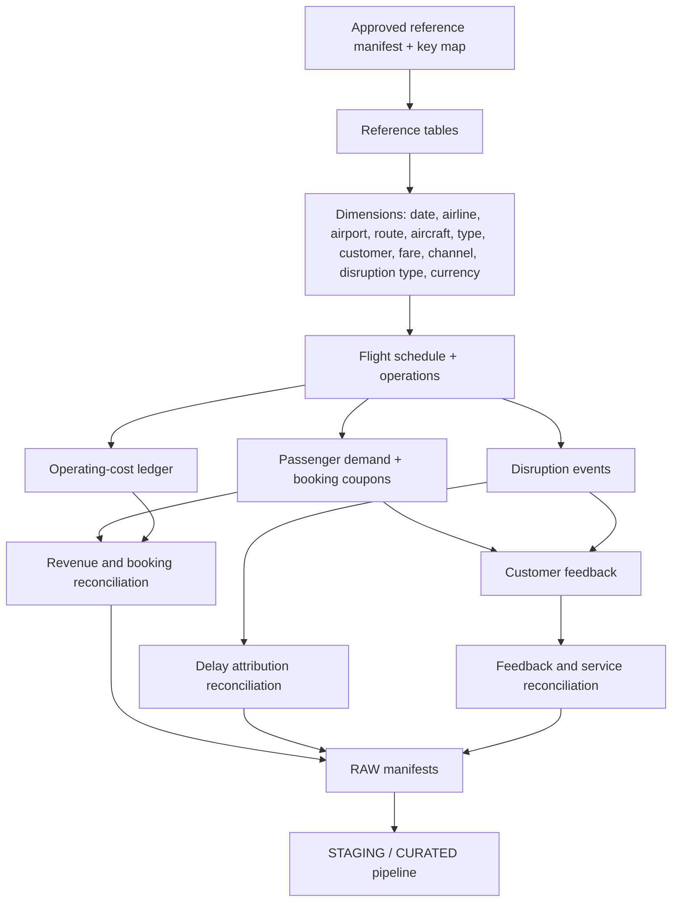

# AEROVISION 360 — Synthetic Data Generation Blueprint

**Status:** ENGINEERING PREPARATION — DESIGNED, NOT GENERATED; NO DATASET CREATED
**Version:** 0.1
**Prepared:** 2026-11-02
**Governing contract:** `docs/03_DATA_CONTRACTS.md` version 1.5
**Companion model:** `docs/ENGINEERING_DATA_MODEL_BLUEPRINT.md`
**Project root:** `C:\Users\KHfar\OneDrive\Desktop\AEROVISION_360`

> **Status notice.** This blueprint describes how synthetic data will be generated after approval. It does not generate data, create reference CSV files, run Python, or authorize G4. OD-01A/OD-01B remain pending signature and approval; G3 is `NOT STARTED`; G4 is `BLOCKED`; schema freeze and reference-data creation are `NOT AUTHORIZED`.

## 1. Purpose and boundary

The purpose is a realistic, internally consistent, reproducible synthetic airline simulation for the fixed ten-airline population and the reporting period 2025-10-01 through 2026-09-30. The airline identities and supported identity attributes are real; every operational, customer, booking, revenue, cost, disruption, feedback, and financial value is synthetic.

**Never present a generated value as actual airline performance.** The exact disclosure is:

`Synthetic Simulation — Not Actual Airline Performance`

The blueprint distinguishes:

- **Reference identity data** — real, source-verified before approval, versioned.
- **Synthetic operating data** — generated from seeded models and labelled synthetic.
- **Analytical classifications** — optional labels such as `BusinessModelClass`; not source-verified identity facts.
- **Open decisions** — assumptions that remain `OWNER DECISION REQUIRED`.

## 2. Fixed inputs

| Input | Value |
|---|---|
| Population | Ten real airline identities in contract Section 2.1 and OD-01A |
| Reporting period | 2025-10-01 through 2026-09-30, inclusive |
| Reporting currency | USD |
| Transaction currencies | USD, EUR, GBP, JPY, CAD (proposed under OD-04) |
| Flight-volume target | 150,000 legs, within the contract range 150,000–250,000 |
| Reference version | One approved `ReferenceVersion` per generation; format `AIR-YYYY-MM-DD-NNN` |
| Time zone | IANA identifiers; UTC timestamps; local date keys |
| Historical model | Type 1 DimAirline; immutable snapshots; no as-was identity labels |

The generator must fail closed if the approved reference manifest, key map, reference files, or selected `ReferenceVersion` is missing or inconsistent.

## 3. Planning assumptions (synthetic, not airline facts)

These are engineering assumptions. They must be labelled synthetic in the generation manifest and must not be described as real airline performance.

| Assumption | Planning value | Notes |
|---|---:|---|
| Average scheduled seats per flight | 150 | Mixed narrowbody/widebody synthetic fleet; not a real fleet claim |
| Booked load factor | 71% | Varies by airline, route, month, and day of week |
| No-show rate | 2%–8% | Applied to booked passengers |
| Non-revenue share of carried passengers | 2%–5% | Award/employee/other; zero for cancelled |
| Cancellation rate | 1.0%–3.0% | Higher in adverse-weather months |
| Flights with at least one disruption event | ~35% | Includes cancellation events with zero delay |
| Feedback sample | ~2% of carried passengers | Synthetic sampling, not a real survey |
| Booking lead time | 0–330 days | Not an approved 365-day maximum; OD-22 remains open |
| Average booking party | 1–4 passengers | Single- and multi-segment itineraries |
| Customer base | 1.0–1.5 million | Synthetic; no real personal data |
| Sales channels | 7 controlled channels | Direct Web, Mobile App, OTA, GDS, Call Center, Corporate, Airport |
| Fare classes | 12 | Cabin/refundability taxonomy; OD-06/OD-07 apply |

All distributions must be documented in the generation configuration and recorded in the manifest. No distribution may be represented as an industry benchmark.

## 4. Generation architecture and dependency graph

**Generation sequence:**

1. Validate approval state, selected `ReferenceVersion`, manifest, key map, and reference hashes.
2. Build DimDate and controlled dimensions from reference.
3. Generate the route network and fleet assignment.
4. Generate flight schedule and operations.
5. Generate passenger demand and coupon-level bookings that reconcile to flight counts.
6. Generate cost ledger lines that reconcile to cost controls.
7. Generate disruption events that partition flight delay or carry zero delay.
8. Generate feedback events linked to valid flights and customers.
9. Write RAW data and manifests; do not clean RAW.
10. Hand RAW to STAGING/CURATED; publish only accepted records.

No stage may write directly to CURATED. No stage may overwrite a published RAW run.

## 5. Reference and dimension generation

Reference data is not generated as synthetic identity. It is created only after OD-01A/OD-01B approval and `G3-RV-01`; the generator loads it read-only.

| Dimension/reference | Generation rule |
|---|---|
| DimDate | Deterministic calendar 2024-10-01 through 2026-10-31; ISO week; fiscal year starting October; `IsReportingPeriod` exactly 2025-10-01 through 2026-09-30 |
| DimAirline | Exactly ten rows from approved `ref_airlines.csv`; load `AirlineKey` from the approved key map; never derive from order; hide `ReferenceVersion` in the model |
| DimAirport | 60–100 synthetic/generic airports with IANA zones, coordinates, country/region; airport codes unique; no real airport performance claims |
| DimRoute | Directional origin-destination pairs; 300–500 routes; distance positive and within 2% of great-circle; route region controlled |
| DimAircraft | 350–450 synthetic aircraft; one operator; type/capacity consistent; planned availability 14.00 hours is OD-10 proposed |
| DimAircraftType | 12–18 generic/fictional types; capacity and range consistent; no real fleet claims |
| DimCustomer | 1.0–1.5 million privacy-safe synthetic customers; no names, emails, phones, addresses, passports, or real identifiers; segments/loyalty controlled |
| DimFareClass | 12 controlled fare classes across Economy/Premium Economy/Business/First |
| DimBookingChannel | 7 controlled channels; direct flag only for airline-owned channels |
| DimDisruptionType | 12–16 controlled types; exact taxonomy requires OD-13; `Unattributed` explicit, not a fallback |
| DimCurrency | USD, EUR, GBP, JPY, CAD; USD is the only reporting currency; exact-date synthetic rates |

**Reference file dependencies:** `ref_airlines.csv`, `ref_airline_sources.csv`, `ref_airports.csv`, `ref_aircraft_types.csv`, `ref_fare_classes.csv`, `ref_booking_channels.csv`, `ref_disruption_types.csv`, `ref_cost_classification.csv`, `ref_currencies.csv`, `ref_exchange_rates.csv`, `ref_aircraft_availability.csv`, `ref_calendar.csv`. All remain `NOT CREATED` until authorized.

## 6. Flight operations generation

### 6.1 Flight identifier and schedule strategy

- `FlightLegID` is deterministic and unique: `FLT-{AirlineId}-{YYYYMMDD}-{FlightNumber}-{Origin}-{Dest}-{Sequence}` truncated to the contract maximum of 40 characters if necessary. The exact format is a generation-configuration parameter; uniqueness is mandatory.
- `FlightNumber` is unique only within airline/date/route/time. The business key is `FlightLegID`; grain uniqueness also uses airline + flight number + scheduled departure date + route + scheduled departure timestamp.
- One row per scheduled leg, including cancelled legs. No codeshare marketing duplicates; marketing-carrier treatment remains OD-16.
- Schedule generation: each airline has 2–4 synthetic hubs and 30–60 routes; frequencies 1–4 per route per day; seasonal multipliers; day-of-week profiles; no impossible aircraft turnaround (minimum 45–90 minutes by type).
- Aircraft assignment: type range and seat capacity must support the route; one aircraft may operate multiple legs per day; `PlannedDailyAvailableHours` and turnarounds must be respected.

### 6.2 Timestamps and status

1. Generate local scheduled departure from the airline/route timetable.
2. Convert to UTC using the origin airport IANA zone and the recorded time-zone database version.
3. Add scheduled block time based on distance and aircraft type; convert arrival to UTC and derive destination local date.
4. Generate delay and cancellation from the flight-status model.
5. For operated flights: actual departure = scheduled + departure delay; actual arrival = actual departure + actual block minutes; arrival delay = actual arrival − scheduled arrival.
6. For cancelled flights: actual timestamps, delay minutes, and block minutes are null; scheduled timestamps and date keys remain.
7. Compute flags and delays from UTC timestamps, not formatted local clock strings. Use whole minutes, rounded half away from zero.

**Flight fields:** `FlightOperationKey`, `FlightLegID`, `FlightNumber`, `AirlineKey`, `RouteKey`, `AircraftKey`, four scheduled/actual UTC timestamps, two local date keys, `AvailableSeats`, `BookedPassengers`, `RevenuePassengers`, `NonRevenuePassengers`, `FlightDistanceKM`, `FlightStatus`, `DepartureDelayMinutes`, `ArrivalDelayMinutes`, `BlockMinutes`, `CancellationFlag`, `CompletionFlag`, `OnTimeFlag`, `OnTimeArrivalFlag`. Types and nullability follow contract Section 6.3.1 and the data-model blueprint.

### 6.3 Capacity and passenger counts

- `AvailableSeats = DimAircraft.SeatCapacity` (scheduled configuration). No overbooking in the baseline.
- `BookedPassengers = round(AvailableSeats × booked_load_factor)`, capped at `AvailableSeats`; includes no-shows.
- `NoShowPassengers = round(BookedPassengers × no_show_rate)`.
- `CarriedPassengers = BookedPassengers − NoShowPassengers`.
- `NonRevenuePassengers = round(CarriedPassengers × nonrevenue_share)`.
- `RevenuePassengers = CarriedPassengers − NonRevenuePassengers`.
- For cancelled flights: `RevenuePassengers = 0`, `NonRevenuePassengers = 0`; `BookedPassengers` may be positive and must not exceed capacity.
- Invariants: `0 <= RevenuePassengers + NonRevenuePassengers <= BookedPassengers <= AvailableSeats`; no negative values; cancelled flights keep scheduled capacity.
- The flight passenger counts are the control totals for coupon generation. Coupon Flown revenue/non-revenue counts must reconcile exactly to these totals.

### 6.4 Flight-status model

- Cancellation probability varies by airline, month, route region, and airport; baseline 1.0%–3.0%.
- Delay probability and severity are synthetic: more frequent short delays, a smaller tail of long delays; severe delays are more likely in adverse-weather months and congested hubs.
- On-time threshold is 15 minutes (OD-09 proposed; formal approval pending). Early flights count as on time.
- No diversion/reaccommodation in the baseline (OD-19 proposed). `FlightStatus` is exactly Operated or Cancelled.
- If a flight is cancelled, create a cancellation disruption event with zero delay and the appropriate cause; do not invent a delay.

## 7. Booking transaction generation

### 7.1 Grain and identifiers

- One row per passenger ticket coupon. `PassengerCount` is always 1.
- `BookingReference` groups one or more coupons; `TicketNumber` groups one or more coupons; `TicketCouponNumber` is positive.
- Deterministic identifiers: `BKG-{AirlineId}-{YYYYMMDD}-{sequence}`; `TKT-{AirlineId}-{sequence}-{coupon}`; coupon primary key is a deterministic integer. Business keys are unique.
- A booking may have 1–4 passengers and 1–2 segments; a two-segment itinerary creates two coupons per passenger. Multi-segment bookings must not duplicate the same flight segment.

### 7.2 Coupon states

The baseline uses final historical states:

| Status | Meaning | Carried? | Passenger revenue? | Fee revenue? |
|---|---|---|---|---|
| Flown | Passenger traveled | Yes | Ticketed/Flown/Refunded rules apply; net of refunds | Per fee fields |
| NoShow | Booked, did not travel | No | Zero | No-show fee may apply |
| Cancelled | Flight cancelled or booking cancelled | No | Zero | Cancellation fee may apply; refund fields may apply |
| Refunded | Ticket refunded before travel | No | Net of refund; may be zero | Fee refund may apply |

`Booked` and `Ticketed` are valid contract statuses but are not used as final historical states except where a controlled data-quality case requires them. A `Refunded` coupon is not part of the flight's carried-passenger count. `Cancelled` coupons remain in the booking fact; `Refunded` and `Cancelled` coupons are excluded from K-16/K-20 eligibility under the proposed OD-18 rule.

### 7.3 Reconciliation strategy

Generate flight-level control totals first, then create coupon demand pools:

- Flown revenue coupons: exactly `FactFlightOperations.RevenuePassengers`.
- Flown non-revenue coupons: exactly `FactFlightOperations.NonRevenuePassengers`.
- No-show coupons: exactly `BookedPassengers − CarriedPassengers` for operated flights.
- Cancelled coupons: represent booked passengers on cancelled flights; `RevenuePassengers` and `NonRevenuePassengers` remain zero.
- Refunded coupons: additional pre-travel refund transactions; they are not counted in the flight's carried or booked-at-departure counts. The booking fact retains the transaction and refund; the flight fact remains the operational control.
- Coupon-to-flight reconciliation is performed on Flown coupons only (T-53). Cancelled coupons reconcile to zero carried passengers. Refunded/NoShow treatment is tested separately (T-48, T-17, T-20, T-47).

This is a synthetic reconciliation convention, not a real airline accounting policy. It must be documented in the data dictionary.

### 7.4 Fare, tax, fee, ancillary, and refund amounts

- Base fare is a function of distance, cabin/fare class, airline profile, season, booking lead time, and demand. Use synthetic fare curves; no real fare data.
- Discount is a positive magnitude, bounded below base fare.
- Tax is a positive pass-through amount; never revenue.
- Fee is a carrier-retained mandatory fee; included in fee revenue.
- Ancillary revenue covers bags, seats, food, Wi-Fi, and similar synthetic services; optional and fare-class eligibility applies.
- Refunds are positive magnitudes and reduce the applicable revenue stream once. No negative refund values.
- Cancellation and no-show fees are positive retained amounts; mutually exclusive on a coupon.
- Convert each amount to USD using the exact-date rate; store original amount, rate, and USD amount.
- Booking-level amounts are allocated to coupons exactly once: pro-rata to base fare; residual to the largest eligible coupon; ties by lowest `BookingTransactionKey` (OD-14 formal approval incomplete).
- `TaxUSD` is excluded from every revenue measure. Revenue identities are recalculated and reconciled at coupon, booking, flight, airline, route, month, and total levels.

### 7.5 Booking fields

`BookingTransactionKey`, `BookingReference`, `TicketNumber`, `TicketCouponNumber`, `CustomerKey`, `AirlineKey`, `FlightOperationKey`, `RouteKey`, `FareClassKey`, `BookingChannelKey`, `BookingDateKey`, `TravelDateKey`, `PassengerCount`, `IsRevenuePassenger`, `BaseFareAmount`, `DiscountAmount`, `TaxAmount`, `FeeAmount`, `AncillaryRevenueAmount`, `RefundAmount`, `AncillaryRefundAmount`, `FeeRefundAmount`, `CancellationFeeAmount`, `NoShowFeeAmount`, `TransactionCurrencyKey`, `ExchangeRateToUSD`, `BaseFareUSD`, `DiscountUSD`, `TaxUSD`, `FeeUSD`, `AncillaryRevenueUSD`, `RefundUSD`, `AncillaryRefundUSD`, `FeeRefundUSD`, `CancellationFeeUSD`, `NoShowFeeUSD`, `NetPassengerRevenueUSD`, `NetFeeRevenueUSD`, `NetAncillaryRevenueUSD`, `TransactionStatus`, `IsRefunded`, `BookingLeadTimeDays`.

Dates: `TravelDateKey` is the local scheduled departure date of the coupon and must be within the reporting period. `BookingDateKey` is the UTC booking date and may precede the period; DimDate covers 2024-10-01 onward. No 365-day maximum is enforced while OD-22 is open.

## 8. Operating-cost generation

- One row per ledger line: flight, category, subcategory, cost date, source document. The combination is unique.
- Cost categories: Fuel, Crew, Maintenance, Airport Charges, Navigation, Sales and Distribution, Overhead, Other.
- Cost model: distance/block-hour driven for fuel, crew, maintenance, navigation; passenger/airport driven for airport charges and distribution; allocated overhead pool for administration/IT/facilities/insurance.
- Synthetic cost shares (planning only): Fuel 32%, Crew 20%, Maintenance 13%, Airport Charges 15%, Navigation 5%, Sales and Distribution 7%, Overhead 6%, Other 2%. These are not real airline benchmarks; they are generation assumptions and must be labelled.
- Positive expense; negative credit/rebate allowed but controlled and reconciled. No personal data or secrets in descriptions.
- Multi-flight or period pools must be allocated with a documented driver (flight hours, seats, passengers, or revenue) and `IsAllocated = TRUE`; allocation must sum exactly to the control pool after rounding.
- Cost classification must match exactly one active `ref_cost_classification.csv` row in the selected version; invalid/ambiguous mappings are quarantined; no fallback to Other.
- Cost control totals by airline-month and category are generated first; ledger lines must reconcile to them at 0.01 USD (proposed engineering threshold, not owner-approved).

**Cost fields:** `OperatingCostKey`, `CostLineID`, `FlightOperationKey`, `AirlineKey`, `RouteKey`, `CostDateKey`, `CostCategory`, `CostSubcategory`, `CostAmount`, `CurrencyKey`, `ExchangeRateToUSD`, `CostAmountUSD`, `CostDescription`, `SourceDocumentNumber`, `IsAllocated`.

## 9. Disruption generation

- One row per event for one flight and one disruption type; `EventSequence` contiguous from 1 per flight.
- Types: Weather, Air Traffic Control, Technical, Crew, Airport, Security, Passenger, Reactionary, Other, plus explicit `Unattributed` for unexplained delay. Exact codes require OD-13.
- For flights with positive arrival delay, generate a delay decomposition that sums to `ArrivalDelayMinutes` within the proposed one-minute engineering threshold. If not explainable, create an `Unattributed` event. For early/on-time flights, events are optional and `DelayMinutes = 0`.
- Cancelled flights may have a cancellation event with zero delay; cancellation is analyzed through FactFlightOperations.
- `PrimaryCauseFlag = TRUE` for exactly one event per flight when a cause is identified; otherwise all false plus an Unattributed event.
- `ReactionaryFlag = TRUE` only when the type is reactionary-eligible, an upstream flight/event is identified in `ReactionaryEvidenceID`, and the source classifies it as reactionary. Never infer reactionary status from the existence of a delay.
- Event location: route origin by default; destination only when explicitly identified; intermediate/en-route locations are out of baseline and quarantined.
- Event date: local date from `EventStartTimestampUTC` using the event airport's IANA zone. `EventEndTimestampUTC` is optional and must be ≥ start.
- Recovery status: Open, In Progress, Resolved, Closed - No Action.
- **Severity is not a contract column.** The master prompt's severity ask is not supported by contract v1.5. Do not add a Severity column without an approved contract change. Use `DelayMinutes`, `DisruptionCategory`, and `RecoveryStatus` as supported descriptors.

**Disruption fields:** `DisruptionKey`, `DisruptionID`, `FlightOperationKey`, `AirlineKey`, `RouteKey`, `EventLocationAirportKey`, `DisruptionTypeKey`, `EventSequence`, `EventDateKey`, `EventStartTimestampUTC`, `EventEndTimestampUTC`, `DelayMinutes`, `PrimaryCauseFlag`, `ReactionaryFlag`, `ReactionaryEvidenceID`, `RecoveryStatus`.

## 10. Customer feedback generation

- One row per feedback event, not one row per comment or survey question.
- Sample approximately 2% of carried passengers, with higher response propensity for delayed/cancelled flights and complaints. Sampling is synthetic and must be recorded.
- Feedback types: Survey 70%, Complaint 20%, Compliment 8%, Claim 2% (planning distribution; varies by airline/route/season).
- Satisfaction score: integer 1–5 for surveys/complaints where collected; null for non-score feedback. Correlate with delay, cancellation, cabin, and service recovery. The scale is OD-11 proposed.
- Complaint category required for Complaint and null otherwise; use controlled synthetic categories such as Delay, Cancellation, Baggage, Seat Comfort, Staff Service, Food, Refund, Boarding, Other.
- `ServiceRecoveryFlag = TRUE` for a subset of complaints that triggered a recovery case; `ResolutionStatus` and `ResolutionDateKey` follow the contract. Resolved requires a resolution date on/after feedback date.
- Feedback date is UTC; feedback must reference a valid flight and customer. No free-text comments in the baseline.
- **Sentiment classification is not a contract column.** The master prompt's sentiment ask is not supported by contract v1.5. Do not invent a sentiment field or model output. Use FeedbackType, SatisfactionScore, ComplaintCategory, and ResolutionStatus as supported evidence. A sentiment view requires `OWNER DECISION REQUIRED` and a contract change.
- **Service category is not a contract column.** Use ComplaintCategory and FeedbackChannel; do not add a service-category field.

**Feedback fields:** `FeedbackKey`, `FeedbackID`, `CustomerKey`, `AirlineKey`, `FlightOperationKey`, `RouteKey`, `FeedbackDateKey`, `FeedbackType`, `SatisfactionScore`, `ComplaintCategory`, `ServiceRecoveryFlag`, `ResolutionStatus`, `ResolutionDateKey`, `FeedbackChannel`.

## 11. Realism, seasonality, and regional patterns

- **Seasonality:** monthly multipliers for Northern/Southern Hemisphere summer, December holidays, and adverse-weather periods. Multipliers are synthetic; do not claim they reflect real airline demand.
- **Day of week:** Friday/Sunday peaks for leisure; Monday/Thursday peaks for business; lower weekend frequencies on some routes.
- **Route region:** derive analytical region from airport/route geography, never from an airline `OperatingRegion` attribute. Use controlled route regions for comparisons.
- **Airline profiles:** distinguish full-service, low-cost, and hybrid operating patterns through synthetic schedule, fare, ancillary, and load-factor parameters. `BusinessModelClass` remains optional and analytical; it is not source-verified.
- **Airports:** 60–100 synthetic/generic airports; hubs and spoke routes; time zones and DST; no real airport performance claims.
- **Fleet:** generic aircraft types with synthetic capacities/ranges; no real fleet claims.
- **Currency:** five currencies; synthetic exact-date rates; no live market data; USD reporting.
- **Time zones:** use IANA zones and a recorded tz database version; test at least one DST transition per affected region, overnight flights, and cross-time-zone date differences.
- **No impossible values:** no negative seats, zero distance, negative fares, refunds beyond paid amounts, resolution before feedback, actual timestamps on cancelled flights, or passengers above capacity. Controlled exceptions must be documented defects, not hidden corrections.

## 12. Determinism and reproducibility

- Master seed is recorded in the generation manifest.
- Per-dataset seeds are derived deterministically from the master seed and dataset name using SHA-256; do not use process-randomized Python hash values.
- Use `numpy.random.default_rng` (PCG64) or an equivalent documented generator; pin the library version.
- Sort keys before assignment; avoid unordered set/dict iteration for ID allocation.
- The same seed, configuration hash, reference version, code version, and tz database version must reproduce the same logical rows, key sets, and control totals.
- `AirlineKey` comes only from the approved immutable key map; it is not derived from row order, sort order, hash order, random selection, `IDENTITY`, or a rebuild sequence.
- Record: run ID, generated-at UTC, generator version, seed, configuration hash, schema version, selected reference version, key-map hash, reference file hashes, tz database version, row counts, and defect injection summary.
- A rerun must not overwrite a published run. Use a new run ID or a documented reproducible-run mode that writes to a separate directory.

## 13. Controlled defect injection

Defects are injected only in RAW, detected in STAGING, and excluded from CURATED. Injection rate is a coverage target, not a CURATED acceptance threshold.

| Defect | Injection rate target | Detection test |
|---|---:|---|
| DQ-01 duplicate source record | 0.50% | Business-key duplicate count |
| DQ-02 missing conditionally required attribute | 2.00% | Conditional null/dependency check |
| DQ-03 invalid foreign key | 0.20% | Anti-join |
| DQ-04 inconsistent text casing | 1.00% | Uppercase/trim comparison |
| DQ-05 invalid date | 0.20% | Date-order/range check |
| DQ-06 negative/impossible numeric value | 0.20% | Range/cross-field check |
| DQ-07 invalid airport code | 0.20% | Regex + referential check |
| DQ-08 currency inconsistency | 0.10% | Code-list/rate join |
| DQ-09 invalid flight status | 0.20% | Allowed-value/cross-field check |
| DQ-10 missing operational timestamp | 0.20% | Null check by status |
| DQ-11 inconsistent booking identifier | 0.10% | Cross-field/duplicate check |
| DQ-12 financial reconciliation exception | 0.05% | Allocation/control reconciliation |
| DQ-13 reactionary misclassification | 0.10% | Evidence check |
| DQ-14 duplicate feedback event | 0.20% | Composite duplicate check |

Every injected defect must be detected, counted, and dispositioned. A detected count below the injected count is a test failure (T-54).

## 14. Reconciliation and business rules

| Rule | Control |
|---|---|
| Flight grain | One row per scheduled leg; no duplicate business key |
| Capacity | `AvailableSeats > 0`; `BookedPassengers <= AvailableSeats`; carried counts <= booked |
| Cancelled flights | Scheduled timestamps/date keys populated; actual timestamps/delays null; carried passengers zero |
| Coupon grain | One row per passenger coupon; `PassengerCount = 1` |
| Coupon-to-flight passengers | Flown revenue coupons = flight revenue passengers; Flown non-revenue = non-revenue passengers; cancelled coupons = zero carried |
| Revenue identity | `NetPassengerRevenueUSD = BaseFareUSD − DiscountUSD − RefundUSD` for Ticketed/Flown/Refunded; zero for Booked/Cancelled/NoShow |
| Fee identity | `NetFeeRevenueUSD = FeeUSD − FeeRefundUSD + CancellationFeeUSD + NoShowFeeUSD` |
| Ancillary identity | `NetAncillaryRevenueUSD = AncillaryRevenueUSD − AncillaryRefundUSD` |
| Tax | Excluded from all revenue; reconciled separately |
| Cost | Ledger sums to airline-month control at 0.01 USD (proposed) |
| Delay | Event delay sums to arrival delay or explicit Unattributed; zero for on-time/early |
| Feedback | Valid customer/flight; resolution date >= feedback date; duplicates removed |
| Dates | No invalid date order; DimDate keys resolve; reporting-period boundaries respected |
| Currencies | Every financial row has an exact-date positive rate; USD conversion matches |
| Reference version | One selected version; no mixed-version facts; key map consistent |

**Note:** 0.01 USD and one-minute thresholds are proposed engineering validation thresholds, not owner-approved acceptance thresholds. OD-20 and related decisions remain open.

## 15. Volume targets

| Dataset | Planning rows | Basis |
|---|---:|---|
| Flight operations | 150,000 | Ten airlines, ~41 legs/day, 365 days |
| Booking transactions | ~16,000,000 | 150,000 flights × 150 seats × 71% load |
| Operating costs | ~1,200,000 | ~8 ledger lines per operated flight |
| Disruptions | ~90,000 | ~0.6 events per scheduled flight |
| Customer feedback | ~300,000 | ~2% sample of carried passengers |
| Dimensions | 10 airlines; 60–100 airports; 300–500 routes; 350–450 aircraft; 1.0–1.5M customers | Synthetic network and customer base |
| Aircraft availability | ~146,000 per version | ~400 active aircraft × 365 days |

These are targets, not generated data. Validate T-03 and Power BI performance before full-volume generation. If the target is infeasible, do not silently reduce the contract population or sample the fact grain; raise `OWNER DECISION REQUIRED`.

## 16. Acceptance and evidence

A generated dataset is acceptable only when:

1. The approved reference version and key map are recorded.
2. RAW files match their manifests and preserve injected defects.
3. STAGING detects every injected defect and records dispositions.
4. CURATED has zero high/critical defects, zero duplicate grain rows, and zero orphan required keys.
5. Financial, passenger, cost, delay, and feedback reconciliations meet the approved thresholds or are explicitly BLOCKED/open.
6. All required tests T-01–T-79 applicable to data are executed with evidence under `qa/results/`.
7. The exact synthetic disclosure is present in the report and export artifacts (T-79; report work is later and currently BLOCKED).
8. G4 authorization exists. No generation before G4.

**Current status:** no data generated; no manifest; no test executed. The generator design is `DOCUMENTED`, not `IMPLEMENTED`.

## 17. Open decisions and unsupported asks

- OD-01A/OD-01B formal signatures and approval dates.
- OD-02 airport/network population; OD-03 fleet; OD-04 exchange rates; OD-05 cancelled capacity; OD-06 passenger revenue; OD-07 tax/fee; OD-08 refunds; OD-09 OTP; OD-10 availability; OD-11 satisfaction; OD-12 complaint rate; OD-13 cost/disruption taxonomy; OD-14 allocation; OD-15 no separate revenue fact; OD-16 codeshare; OD-17 service recovery; OD-18 repeat/lead eligibility; OD-19 diversion; OD-20 passenger tolerance; OD-21 targets; OD-22 maximum lead time; OP-01 cohort complaint rate.
- Severity, sentiment, and service category are requested in the master prompt but are not columns in contract v1.5. They are `OWNER DECISION REQUIRED` and must not be invented.
- The 365-day booking-lead-time maximum is proposed but not approved (OD-22). The generator uses a 0–330-day sampling window for coverage; that is not a policy maximum.
- Overbooking is not in the baseline. Any exception requires a documented contract change and test.
- The planning distributions are synthetic assumptions, not airline benchmarks or forecasts.

## 18. Verification checklist for this blueprint

| Check | Status |
|---|---|
| Reporting period and population explicit | DOCUMENTED |
| Real identity vs synthetic operating boundary | DOCUMENTED |
| Five fact generation methods defined | DOCUMENTED |
| Flight/coupon/cost/delay/feedback reconciliation rules | DOCUMENTED |
| Deterministic seed/key policy | DOCUMENTED |
| Reference-version and key-map dependency | DOCUMENTED |
| Controlled defect injection | DOCUMENTED |
| Volume targets and performance caveat | DOCUMENTED |
| No dataset or production code created | VERIFIED BY ABSENCE |
| G4 / schema freeze | BLOCKED / NOT AUTHORIZED |

**End of blueprint.** No synthetic dataset, reference CSV, manifest, Python script, or pipeline output was created by this document.
